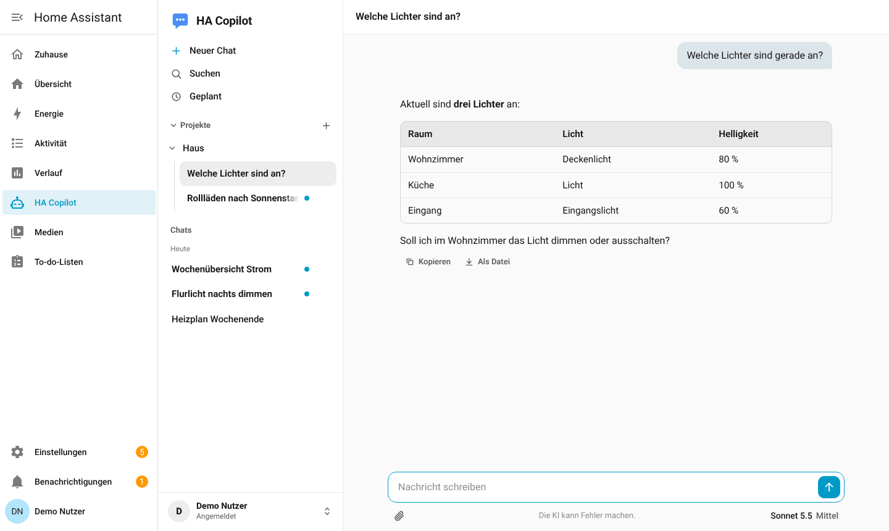
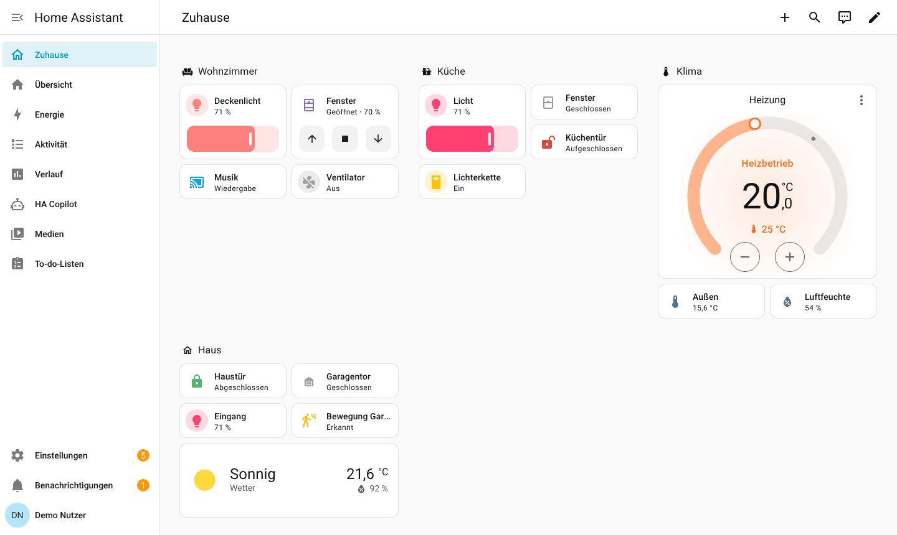

# HA Copilot

[](https://github.com/dominikramachers/HA-Copilot/actions/workflows/ci.yml)

Ein eigener KI-Chat als Add-on für Home Assistant: Claude im Sidebar-Panel von Home Assistant, optional zusätzlich über eine eigene Domain mit Anmeldung per Microsoft Entra ID oder Home Assistant. Chats sind pro Benutzer getrennt, bleiben gespeichert und lassen sich wie in Claude selbst in Projekten ordnen.

*In short: a self-hosted Claude chat UI for Home Assistant (Ingress panel, per-user chats, projects, attachments, optional public domain with Entra ID sign-in). The interface is available in German (default) and English (option `language`).*

> **Inoffizielles Projekt.** Nicht von Anthropic oder Nabu Casa. „Claude“ ist eine Marke von Anthropic.



| Seitenleiste und Dashboard | Dunkel | Handy |
|---|---|---|
|  |  |  |

*Die Bilder zeigen eine Test-Instanz von Home Assistant mit Demo-Geräten und Beispiel-Chats, keine echten Daten. Wie sie entstanden sind, steht in [docs/screenshots/README.md](docs/screenshots/README.md).*

## Dokumentation

| Seite | Inhalt |
|---|---|
| [Installation](docs/installation.md) | Repository hinzufügen, installieren, Zugang zu Claude, erster Start, Einrichtungsprüfung, Updates |
| [Benutzer und Rechte](docs/benutzer.md) | Ersten und weitere Benutzer anlegen, Rechtestufen der KI, „alle HA-Benutzer“ |
| [Alle Einstellungen](docs/einstellungen.md) | Jede Option mit Standardwert und Bedeutung |
| [Funktionen](docs/funktionen.md) | Chat, Projekte, Suche, Home Assistant, GitHub, Gedächtnis, geplante Aufgaben, Dateien |
| [Domain-Zugang](docs/domain-zugang.md) | Entra-ID-Anmeldung, Cloudflare Tunnel, Anmeldung mit Home Assistant |
| [Betrieb](docs/betrieb.md) | Sicherung, Wiederherstellung, Umzug, Protokoll, Fehlerbehebung |
| [Ausführliche Referenz](ki_chat/DOCS.md) | Alles bis ins Einzelne (erscheint auch im Reiter „Dokumentation“ des Add-ons) |
| [Änderungen](ki_chat/CHANGELOG.md) | Was sich in welcher Version geändert hat |

## Funktionen

- Antworten als Live-Stream mit Markdown, Tabellen, Codeblöcken (Kopieren, Herunterladen) und HTML-Vorschau
- **Antworten laufen auf dem Server weiter:** Chat wechseln, Seite neu laden oder Tab schließen verliert nichts; fertige Antworten erscheinen als ungelesen
- **Zugriff auf Home Assistant** mit Rechtestufen je Benutzer (nichts, lesen, ausführen, ändern), Rückfrage im Chat vor Änderungen und Sperrliste für gefährliche Befehle
- Chats pro Benutzer getrennt, Projekte mit Anweisungen, Anpinnen, Umbenennen, automatische Kurztitel
- **Suche** in allen eigenen Chats (Strg/Cmd+Umschalt+F), Export als Markdown oder ZIP, eigene Chats gesammelt löschen
- **Dateien erzeugen und bearbeiten:** Word, Excel, PowerPoint, PDF und Skripte (PowerShell, Shell, Python …) zum Herunterladen; angehängte Dateien (PDF-Formulare, Word, Excel, PowerPoint, Text und Code) liest und ändert die KI auf Wunsch, das Original bleibt unverändert
- **GitHub:** Repositories lesen, Code durchsuchen, Issues und Pull Requests ansehen; mit Schreibrecht Commits, Zweige und Pull Requests (jede Änderung wird im Chat bestätigt)
- **Websuche** und Seiten lesen, wählbare Modelle, Hinweis auf das Nutzungslimit des Abos
- **Geplante Aufgaben** (lesend, ohne Rückfragen) mit Benachrichtigung im Chat, in Home Assistant oder aufs Handy
- Dateianhänge bis 50 MB: Bilder, PDF, Word, Excel, PowerPoint, Text und Code (zum Bearbeiten als Kopie im Chat, sonst nur im Arbeitsspeicher)
- Lange Chats werden automatisch zusammengefasst, statt abgeschnitten zu werden
- Zugang über das HA-Panel (Ingress) und optional über eine eigene Domain mit Entra-ID-Anmeldung oder „Mit Home Assistant anmelden“
- **Deutsch oder Englisch** (Option `language`, Standard Deutsch)
- Benutzer, Name, Logo, Texte und Farben in der Add-on-Konfiguration; das Theme von Home Assistant wird übernommen
- Tägliche, geprüfte Datenbank-Schnappschüsse; HA-Sicherung im gestoppten Zustand (`backup: cold`)

## Installation

1. In Home Assistant **Einstellungen → Add-ons** (ab 2026.2 „Apps“) → **Add-on-Store → ⋮ → Repositories** öffnen und diese Adresse hinzufügen:
   `https://github.com/dominikramachers/HA-Copilot`
2. **HA Copilot** installieren, auf dem Reiter Info **In der Seitenleiste anzeigen** einschalten.
3. In der Konfiguration deinen Benutzer eintragen (`ha_user` = dein HA-Benutzername) und die Zugangsdaten zu Claude hinterlegen (siehe unten). Bis dahin läuft das Add-on im Testmodus (`backend: echo`) ohne KI.
4. `backend` auf `claude` stellen, Add-on starten, „HA Copilot“ erscheint in der Seitenleiste.

Die ausführliche Anleitung mit Bildern: [docs/installation.md](docs/installation.md). Benutzer und Rechte: [docs/benutzer.md](docs/benutzer.md). Alle Optionen: [docs/einstellungen.md](docs/einstellungen.md).

## Zugang zu Claude

Du brauchst eigene Zugangsdaten. Sie werden nur in deiner Add-on-Konfiguration gespeichert und sind nicht Teil dieses Repositorys.

> **Wichtig zum Abo-Token.** Das Add-on kann sich mit einem Claude-Abo (Pro oder Max) über `claude setup-token` anmelden. Das ist **nur für deinen eigenen, persönlichen Gebrauch** gedacht. Nach den Nutzungsbedingungen von Anthropic darfst du Abo-Zugänge nicht für andere Personen über ein Programm bereitstellen und nicht weitergeben; Anthropic kann solche Tokens sperren oder die Nutzung einschränken. Trägst du mehrere Benutzer ein, aktivierst du den Zugang über eine Domain oder teilst den Chat mit anderen, ist der **API-Schlüssel** der richtige Weg. Ich bin kein Rechtsberater: Lies die aktuellen Bedingungen von Anthropic selbst und entscheide eigenverantwortlich. Das Add-on weist beim Start im Protokoll und in der Einrichtungsprüfung darauf hin, wenn ein Abo-Token mit mehreren Benutzern oder der Domain-Seite zusammentrifft.

- **API-Schlüssel** (`anthropic_api_key`, aus der [Claude-Konsole](https://platform.claude.com/)): der von Anthropic vorgesehene Weg für Programme, Abrechnung nach Verbrauch. Empfohlen, sobald mehr als eine Person das Add-on nutzt.
- **Abo-Token** (`claude_oauth_token`, per `claude setup-token`): nur für deinen eigenen, persönlichen Gebrauch, siehe Hinweis oben.

## Datenschutz und Sicherheit

- Chats liegen in einer SQLite-Datenbank im Add-on-Speicher (Teil der HA-Sicherung). Texte deiner Nachrichten und Anhänge gehen zur Beantwortung an Anthropic; sonst an niemanden.
- Dateianhänge: In der Datenbank stehen Name, Art und Größe. Mit der Option „Dateien bearbeiten“ (Standard) legt das Add-on außer bei Bildern eine Kopie für diesen Chat im Datenordner ab (`files_keep_days` Tage, mit dem Chat gelöscht); mit `files_edit: false` bleiben Anhänge nur im Arbeitsspeicher.
- Die Domain-Anmeldung prüft die Identität serverseitig (OIDC mit PKCE, serverseitige Sitzungen, Schutz gegen Cross-Site-Anfragen). Das Add-on gibt den Port der Domain-Seite nicht nach außen frei; ein Tunnel (z. B. Cloudflare) ist deine Entscheidung.
- Das Add-on legt von sich aus keinen Zugang über das Internet an. Wer die Domain-Seite aktiviert, sollte vorher [docs/domain-zugang.md](docs/domain-zugang.md) und [ki_chat/DOCS.md](ki_chat/DOCS.md) lesen.

## Entwicklung

```bash
cd ki_chat
pip install -r requirements.txt pytest pyyaml
python -m pytest -q
```

Die Tests laufen ohne Claude-Zugang (Test-Backend). Der Testmodus des Add-ons (`backend: echo`) verursacht ebenfalls keine Kosten. Die Seite [Alle Einstellungen](docs/einstellungen.md) wird mit `python tools/gen_options_doc.py` aus `config.yaml` erzeugt; ein Test prüft, dass sie aktuell ist und alle Links und Bilder der Dokumentation existieren.

## Lizenz

[MIT](LICENSE). Mitgelieferte Schriften: Roboto und Atkinson Hyperlegible Mono (jeweils SIL Open Font License 1.1, Lizenztexte unter `ki_chat/app/static/fonts/`).
