# Funktionen

Ein Überblick über alles, was HA Copilot kann, mit den Einstellungen, die dazugehören. Jeder Abschnitt verweist auf die ausführliche Beschreibung in der [Add-on-Dokumentation](../copilot/DOCS.md). Alle Optionen mit Standardwerten stehen in [Alle Einstellungen](einstellungen.md).

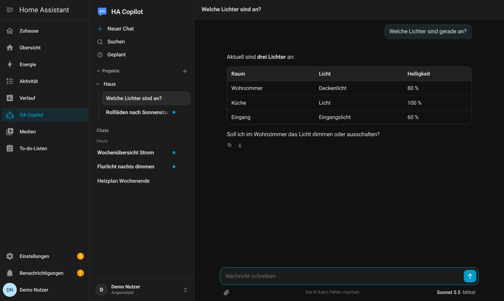

## Chat

- Antworten erscheinen als **Live-Stream** mit Markdown, verschachtelten Stichpunkten, Tabellen und Codeblöcken (kompakt, mit Knöpfen zum Kopieren und Herunterladen, schon während die Antwort läuft). Vollständige HTML-Seiten bekommen eine **Vorschau**, die abgeschottet und ohne Netzwerk läuft.
- **Antworten laufen auf dem Server weiter.** Du kannst den Chat wechseln, die Seite neu laden oder den Tab schließen; die Antwort wird trotzdem fertig und steht danach als ungelesen in der Liste. Mit „Stopp“ brichst du sie ab.
- Pro Nachricht lässt sich die **Denktiefe** wählen (Niedrig, Mittel, Hoch), dazu das **Modell** und die **Websuche**. Alles steht in einem Menü (Knopf z. B. „Sonnet 5.5 Mittel“; am Computer rechts unter dem Eingabefeld, am Handy im Eingabefeld neben der Büroklammer), wie in Claude: gewähltes Modell, „Aufwand“ und „Weitere Modelle“ als Untermenüs.
- **Anhänge** (bis zu 5 je Nachricht, zusammen 60 MB): Bilder, PDF, Word, Excel, PowerPoint, Text und Code. Mit der Option „Dateien bearbeiten“ (Standard) bleibt eine Kopie für diesen Chat erhalten, damit die KI die Datei später lesen und **bearbeiten** kann (z. B. PDF-Felder sperren, PDF-Text ersetzen, Word-Text ändern, Excel-Zellen setzen, Code anpassen; Excel-Diagramme und -Bilder bleiben dabei erhalten); die bearbeitete Fassung gibt es als Download, das Original bleibt unverändert. Ohne die Option gibt es die Anhänge nur im Arbeitsspeicher. Einfügen mit Strg/Cmd+V oder Ziehen auf die Seite geht auch. **Langer Text** (ab etwa 1500 Zeichen oder 20 Zeilen), den du einfügst, wird wie in Claude automatisch ein Anhang („Eingefügter Text“) statt Rohtext im Eingabefeld; du kannst ihn im Chat antippen und die KI sieht ihn auch bei Folgefragen.
- **Auf einen Ausschnitt antworten:** Text in einer Antwort markieren und **Antworten** wählen: der Ausschnitt steht als Zitat über dem Eingabefeld (mit **x** wieder entfernbar) und über deiner Nachricht im Chat. Die KI bekommt das Zitat mit.
- **Einführung und Neuerungen:** Beim ersten Anmelden erklärt ein Fenster („Hallo, ich bin …“), wofür die KI da ist, was sie kann und wie man sie am Computer oder am Handy bedient; mit **Okay** erscheint es nie wieder. Nach einem Update zeigt ein Fenster einmalig, was neu ist, in einfacher Sprache. Beides lässt sich im Konto-Menü unten links nachlesen (**Kurzanleitung**, **Das ist neu**).
- **Einstellungen und Konto-Menü:** Unten links öffnet das Konto-Menü **Einstellungen**, **Nutzung**, die **Einrichtungsprüfung** (in Home Assistant) und **Abmelden** (Domain); auf dem Handy öffnet der Tipp auf den Namen gleich die Einstellungen (Abmelden steht dort unten). Am Laptop und Tablet öffnen die Einstellungen als großes Fenster über dem Chat (wie bei Claude), auf dem Handy als eigene Seite. Darin (Liste links) stehen Allgemein (Design), Nutzung (Balken für Sitzungs- und Wochenlimit mit Rücksetzzeit, Bilder im Monat), Gedächtnis, GitHub, Meine Daten und Hilfe. Skills, Konnektoren und Plugins stehen unter **Anpassungen** in der Seitenleiste. Nach dem Neuladen bleibst du auf der Seite, auf der du warst. Mehr: [Einstellungen](../copilot/DOCS.md#einstellungen-und-konto-menü-ab-0481).
- **Nachrichten bearbeiten:** Unter jeder eigenen Nachricht erscheint beim Darüberfahren, wann sie gesendet wurde („vor 33 Minuten“, „vor 2 Stunden“, „Heute Morgen“, „Gestern“, „Vorgestern“, „vor 3 Tagen“, ab einer Woche das Datum), dazu **Bearbeiten** (Stift) und **Kopieren**. Beim Bearbeiten ersetzt die neue Frage die alte und alles danach in diesem Chat; scheitert die neue Antwort, bleibt der alte Verlauf erhalten. Dateien der alten Frage müssen neu angehängt werden.
- **Unter den Antworten der KI** stehen **Kopieren** und **Als Datei** als dezente Symbole, bei der letzten Antwort dauerhaft, bei älteren beim Darüberfahren. Dort erscheint dann auch, wann die Antwort fertig wurde.

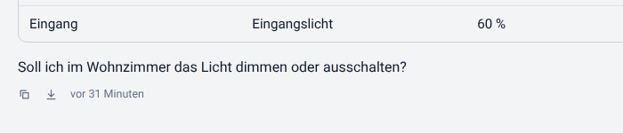

| Zeitpunkt, Bearbeiten, Kopieren | Nachricht bearbeiten |
|---|---|
| 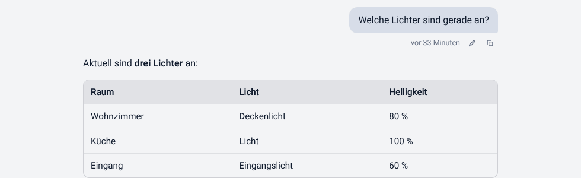 | 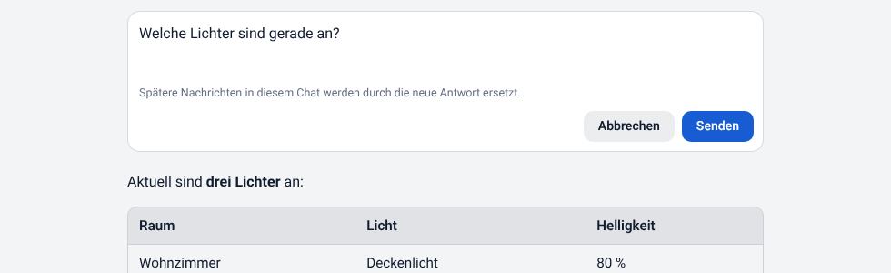 |

- **Wie in Claude:** Unter der letzten Antwort gibt es **Antwort neu erzeugen** (bei Nachrichten ohne Dateianhang), ein runder **Pfeil nach unten** springt ans Ende des Chats, und Codeblöcke zeigen ihre Sprache als kleine Marke.
- **Lange Antworten** bleiben beim Entstehen mit ihrem Anfang oben im Bild stehen: Du liest von vorn, der Chat springt weder mit noch am Ende nach unten. Scrollst du selbst, wird dir das nicht aus der Hand genommen.
- Lange Chats werden **automatisch zusammengefasst**, statt abgeschnitten zu werden.
- Ein kurzer **Titel** entsteht automatisch, und jeder Chat lässt sich umbenennen.

Mehr: [Bilder](../copilot/DOCS.md#bilder-ab-0280), [Oberfläche](../copilot/DOCS.md#oberfläche), [So arbeitet die KI](../copilot/DOCS.md#so-arbeitet-die-ki), [Dateien bearbeiten](../copilot/DOCS.md#dateien-bearbeiten-ab-0270), [Anhänge und Speicherplatz](../copilot/DOCS.md#anhänge-und-speicherplatz).

## Projekte, Suche, Export

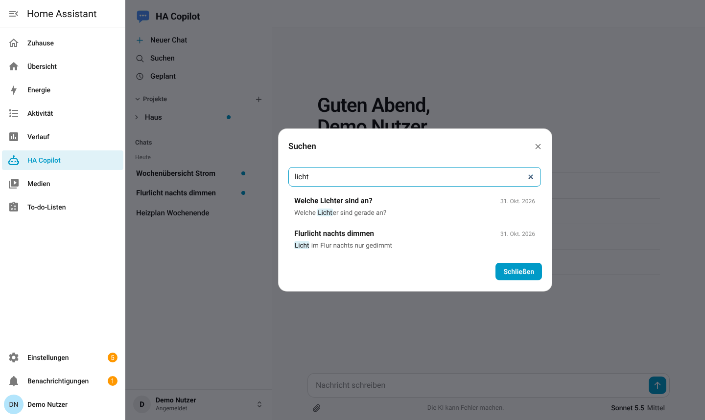

- **Projekte** ordnen Chats und tragen **Anweisungen** (bis 4000 Zeichen), die in jedem Chat des Projekts mitgehen. Zu einem Projekt kannst du **Wissen** hochladen (Notizen, Word, Excel, PDF, ZIP); die KI liest bei Bedarf nach. Auf Wunsch („speichere das im Projektwissen“) schreibt sie auch selbst Notizen dazu, im Ordner `KI/`; deine hochgeladenen Dateien ändert sie nie.
- **Suchen** (Strg/Cmd+Umschalt+F) durchsucht Titel und Nachrichten aller deiner Chats, ohne Rücksicht auf Groß- und Kleinschreibung und Umlaute. Schon vor der ersten Eingabe zeigt das Fenster laufende und zuletzt benutzte Chats; Reiter trennen Chats, Projekte und geplante Aufgaben, Pfeiltasten und Enter genügen zur Bedienung.
- **Tastenkürzel** am Computer: Strg (Mac: ⌘) + Umschalt + **O** neuer Chat, **F** Suchen, **P** neues Projekt, **G** geplante Aufgaben. Das Kürzel steht in der Seitenleiste erst, wenn du mit der Maus über den Eintrag fährst.
- **Hinweise über dem Eingabefeld:** Nutzungslimit und Rückfragen der KI (z. B. vor einer Änderung in Home Assistant) erscheinen als Streifen direkt über dem Eingabefeld, wie in Claude selbst, jeweils als eigene schmale Box (nicht am Eingabefeld angebaut).
- Anpinnen, umbenennen, in ein Projekt verschieben, als Markdown exportieren, löschen: alles im Menü (⋯) jeder Zeile.

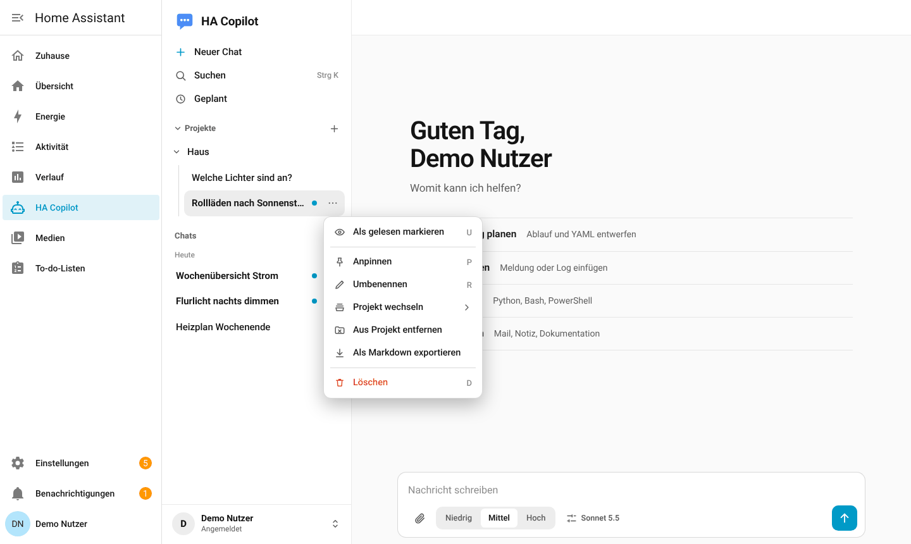

- Unter **Einstellungen → Meine Daten** exportierst du alle Chats als ZIP oder löschst sie unwiderruflich.

Mehr: [Suche, Export und eigene Daten](../copilot/DOCS.md#suche-export-und-eigene-daten-ab-0220).

## Zugriff auf Home Assistant

Die KI kann Home Assistant benutzen: Zustände ansehen, Verlauf und Logbuch lesen, Geräte schalten und, mit der höchsten Stufe, Automationen, Skripte, Szenen, Dashboards und Helfer bauen. Beispiele:

- „Welche Lichter sind gerade an?“
- „Schalte das Wohnzimmer aus.“
- „Lege eine Szene für den Abend an.“
- „Warum ging die Automation ‚Flurlicht‘ gestern nicht an?“

Was erlaubt ist, hängt von der **Stufe je Benutzer** ab (`none`, `read`, `execute`, `write`, siehe [Benutzer und Rechte](benutzer.md#rechte-der-ki)). Änderungen fragen im Chat nach, Schlösser, Alarmanlagen und Garagentore **immer**. Neustart, Updates, Sicherungen und Benutzerverwaltung sind **nie** möglich. Unter jeder Antwort steht einklappbar, was die KI in Home Assistant getan hat. Vor jeder Änderung an Automationen, Skripten, Szenen und Dashboards sichert das Add-on die alte Fassung (die letzten 60).

Standardmäßig sieht und bedient die KI nur Entitäten, die du in Home Assistant für Assist freigegeben hast (`chat.ha_limit_to_exposed`).

Mehr: [Zugriff auf Home Assistant](../copilot/DOCS.md#zugriff-auf-home-assistant-ab-0150), [Smarthome-Überblick](../copilot/DOCS.md#smarthome-überblick-ab-0170).

## Gedächtnis

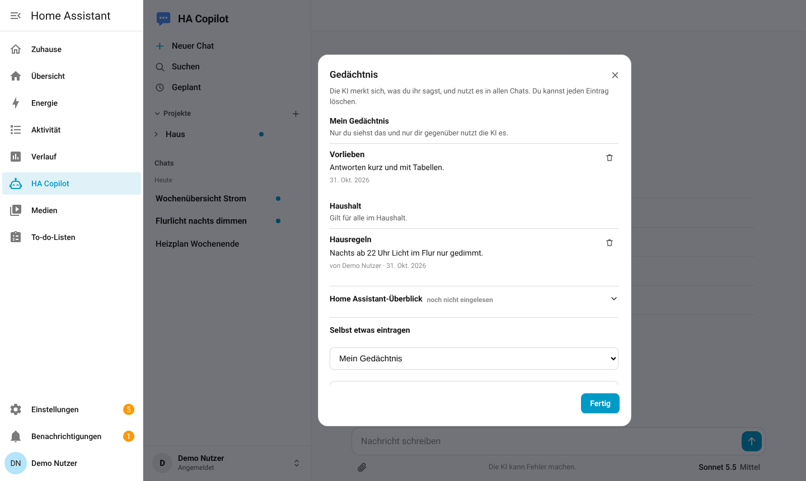

Die KI merkt sich dauerhafte Dinge in kurzen Einträgen und entscheidet selbst, wann das sinnvoll ist (Vorlieben, Entscheidungen, laufende Vorhaben; nicht einmalige Aufträge wie „schreib das kürzer“). Was sie gemerkt hat, steht unter der Antwort. Getrennt wird in **Haushalt** (nur Smarthome-Wissen für alle) und **Person** (alles andere, nur du). Du siehst, ergänzt und löschst Einträge in den **Einstellungen** unter **Gedächtnis**. Alle Personen dürfen den Haushalt ergänzen. Mit `chat.memory_enabled: false` ist die Funktion aus.

Im selben Fenster stehen **Meine Anweisungen** (ein Text, der in all deinen Chats mitgeht, etwa „Antworte kurz und duze mich“) und **Aus Claude übernehmen**: Du exportierst dein Gedächtnis bei Claude als ZIP mit Markdown, wählst die Datei hier aus, siehst jeden Fund mit Haken und übernimmst nur, was du willst. Die Vorlieben aus Claude werden zu deinen Anweisungen.

Zusätzlich liest das Add-on selbst einen **Smarthome-Überblick** (Bereiche, Entitäten je Typ, Integrationen, Namen von Automationen) ein und legt ihn als schreibgeschützte Einträge ab. Das kostet keine KI-Nachricht. Es läuft beim ersten Start und danach wöchentlich; mit `chat.memory_enabled: false` ist es aus.

Mehr: [Projektwissen und Gedächtnis](../copilot/DOCS.md#projektwissen-und-gedächtnis-ab-0160).

## Skills

Ein **Skill** ist eine Anleitung für die KI zu einer bestimmten Art von Aufgabe, etwa „Zabbix-Templates erstellen“ oder „Angebote schreiben“. Du findest sie auf der Seite **Anpassungen** in der Seitenleiste (Reiter „Skills“; „Konnektoren“ und „Plugins“ siehe unten). Sie gelten für dich in allen Chats. Du fügst Skills hinzu, indem du sie importierst (`SKILL.md`, `.skill` oder ZIP, mit Vorschau), per **GitHub-Link** aus einem öffentlichen Repository holst, selbst schreibst oder unter **Entdecken** mit einem Klick übernimmst (70 geprüfte Skills in acht Kategorien, mit Suche, zum Beispiel für Marketing, Social Media, Gestaltung und Büro). Auch deine eigenen Skills lassen sich durchsuchen; jede Karte hat ein kleines Symbol. Die KI sieht nur Name und Beschreibung und lädt ein Skill von selbst, wenn die Aufgabe passt; auch geplante Aufgaben nutzen sie (nur lesend).

Die mitgelieferten Gestaltungsregeln für Word, PowerPoint, Excel, PDF und HTML stehen als **Standard-Skills** unter „Meine“; sie lassen sich nicht abschalten, aber eigene Skills gehen ihnen vor. Skripte in einem Skill werden **nie ausgeführt**, und importierte Skills gelten als fremder Inhalt: Danach fragt die KI vor Änderungen in Home Assistant oder bei GitHub nach.

Mehr: [Skills](../copilot/DOCS.md#skills-ab-0360).

## Konnektoren

Ein **Konnektor** verbindet die KI mit einem Dienst außerhalb von Home Assistant über das Model Context Protocol (MCP), zum Beispiel mit deinem Zabbix-Server. Du findest sie auf der Seite **Anpassungen** im Reiter „Konnektoren“. Der Reiter ist wie „Skills“ aufgebaut: **Meine** (deine eigenen Konnektoren stehen oben), **Entdecken** (ein Katalog mit 31 Diensten, zum Beispiel Gmail, Google Kalender, Notion oder Sentry, mit Logos und Suche) und **Community** (Suche im offenen MCP-Register, nicht geprüft). Dort verbindest du Konnektoren mit einem Klick (Token eintragen oder beim Dienst anmelden) und schaltest einzelne Werkzeuge ein oder aus. Google braucht eine eigene App in der Google Cloud Console, Microsoft 365 gibt es nur als Anleitung für einen selbst betriebenen Server. Eigene Konnektoren bekommen auf Wunsch ein **Logo** (Link oder Upload, PNG/JPEG/GIF/WebP bis 128 kB). Wer die Stufe `own` hat, legt eigene (private) Konnektoren an, wer `global` hat, auch Konnektoren für alle (`connector_access` je Benutzer, vorgegeben `use`).

Werkzeuge, die nur lesen, sind gleich an. Werkzeuge, die etwas verändern oder senden, sind aus, bis du sie einschaltest, und die KI fragt vor jeder Änderung im Chat nach. Was ein Konnektor liefert, gilt als fremder Inhalt (wie Webseiten): danach fragt die KI vor Änderungen auch in Home Assistant oder bei GitHub nach. Zugangsdaten liegen verschlüsselt im Add-on; Adressen im Heimnetz (auch mit `http`) dürfen alle eintragen, die Konnektoren anlegen dürfen. Geplante Aufgaben nutzen nur lesende Werkzeuge.

Mehr: [Konnektoren](../copilot/DOCS.md#konnektoren-ab-0410).

## Plugins

Ein **Plugin** ist ein Paket aus Skills und Konnektoren zu einem Thema, zum Beispiel „Entwicklung“ oder „Büro & Dokumente“. Du findest sie auf der Seite **Anpassungen** im Reiter „Plugins“, aufgebaut wie die anderen Reiter: **Meine**, **Entdecken** (10 Pakete) und **Von GitHub-Link**. Ein Klick auf **Hinzufügen** legt die Skills an und die Konnektoren als „nicht verbunden“ (verbunden wird bei den Konnektoren); wo eine eigene App nötig ist (Google), steht ein Hinweis. Wer ein Claude-Plugin auf GitHub gefunden hat, gibt den Link an: Du siehst in einer Vorschau, was übernommen wird, und kreuzt an, was du willst. Übernommen werden nur Skills und Server-Adressen, nie Befehle, Unteragenten oder Skripte; importierte Skills gelten als fremder Inhalt. Beim **Entfernen** verschwindet nur, was das Plugin selbst angelegt hat.

Mehr: [Plugins](../copilot/DOCS.md#plugins-ab-0430).

## GitHub

Sobald du dein GitHub-Konto verbunden hast, arbeitet die KI mit deinen Repositories: lesen, Code durchsuchen, Issues und Pull Requests ansehen, und mit Schreibrecht Dateien einchecken, Zweige und Pull Requests anlegen. Jede Änderung wird im Chat bestätigt; Commits auf den Hauptzweig, Workflow-Dateien und das Mergen immer. Wer nichts verbindet, hat kein GitHub: ein gemeinsames Token des Administrators gibt es nicht mehr.

Einrichtung für dich:

1. Unten links im Konto-Menü **Einstellungen** öffnen und dort **GitHub** wählen (der Eintrag erscheint, wenn der Administrator dir `read` oder `write` gegeben hat).
2. **Mit GitHub verbinden** wählen, den angezeigten Code bei GitHub eingeben und bestätigen. Alternativ **Token einfügen**.
3. Fertig: Der Dialog zeigt „Verbunden als …“. **Trennen** löscht das Token wieder.

Für den Administrator: Die Rechte (`github_access` je Benutzer, `chat.github_access_default`, Standard `none`) stehen weiter in der Konfiguration. Die Tokens der Personen liegen verschlüsselt im Add-on. Ein gemeinsames Token (`github_token`) und die Freigabeliste `github_repos` gibt es seit 0.47.0 nicht mehr; alte Einträge in der Konfiguration kannst du löschen.

Mehr: [GitHub](../copilot/DOCS.md#github-ab-0190).

## Sprechen mit der KI

Mit dem Mikrofon-Knopf neben **Senden** sprichst du mit der KI („Aria, mach das Licht im Wohnzimmer aus“; der Name ist `look.app_name`). Ein Fenster mit leuchtender Partikel-Kugel (zum Wegwischen mit Maus oder Finger) zeigt, ob sie zuhört, nachdenkt oder antwortet; Stumm, Sprechen und Beenden liegen darunter. Befehle, die Home Assistant selbst versteht, laufen ohne KI und deshalb sofort. Schlösser, Alarmanlagen, Sirenen, Tore, Garagen und die Haustür bedient die KI per Sprache nie, das geht nur getippt. Aus ist der Standard: `voice.access_default` (Gruppe „Sprechen mit der KI“ in der Add-on-Konfiguration) oder je Person `voice_access`. Ein Gespräch aus der Startseite steht nicht in der Chatliste (löscht sich nach `voice.chat_days` Tagen), ein Gespräch mitten in einem Chat gehört zu diesem Chat. Das Mikrofon braucht `https`. Mit einem OpenAI-Schlüssel (`voice.openai_api_key` oder der gemeinsame `images.openai_api_key`) erkennt und spricht OpenAI statt Whisper und Piper; die Einrichtung steht in [API-Konto für Bilder und Sprache](bilder-konten.md#openai-für-die-sprache-spracherkennung-und-stimme). Fehlen Whisper oder Piper oder laufen sie nicht, weicht das Sprechen auf den Browser bzw. die Gerätestimme aus und die Einrichtungsprüfung sagt, was zu tun ist. Auf dem Handy schaltet schon das Antippen die Sprachausgabe frei; klappt das Vorlesen trotzdem nicht, steht die Antwort als Text im Fenster. Die Stimme fängt schon beim ersten fertigen Satz an; die Antworten sind kurz und ohne Gerätenamen, eigene Wünsche dazu stehen in `voice.instructions`; wie lange Erkennung, KI und Stimme brauchen, steht je Runde im Protokoll. Mehr in der [Dokumentation](../copilot/DOCS.md#sprechen-mit-der-ki-ab-0520).

## Websuche und Modelle

- Die KI sucht im Web und liest Seiten, wenn es nötig ist oder du darum bittest. Pro Benutzer steuerbar (`web_access`). Seiten aus dem Heimnetz und interne Adressen werden nie geladen.
- `chat.model` ist das Standardmodell; Opus und Haiku sind im Chat zusätzlich wählbar.
- Ist ein Limit deines Abos fast erreicht, erscheint oben im Chat ein Hinweis mit der Zeit der Rücksetzung.

Mehr: [Web, Modell und Nutzungslimit](../copilot/DOCS.md#web-modell-und-nutzungslimit-ab-0200).

## Dateien erzeugen

Auf Wunsch legt die KI **Word, Excel, PowerPoint, PDF** und Skripte (PowerShell, Shell, Python …) an. Unter der Antwort erscheint eine Karte mit Download. Die Dateien bleiben 14 Tage und gehören nur dir. Abschalten mit `chat.files_enabled: false`.

Die KI gestaltet neue Dateien nach Designregeln (Leitfäden, sieben Farbthemen, auf Wunsch deine Markenfarbe), mit großer Schrift, Kartenfolien, Bildfolien, farbigen Titel- und Zwischenfolien, Seitenzahlen und aufgeräumten Tabellen; auch für HTML-Präsentationen gibt es einen Leitfaden. Sie bettet Bilder, SVG-Zeichnungen und Diagramme ein, setzt ein Inhaltsverzeichnis, Links, Deckblätter, Zitat-, Kennzahlen- und Zwei-Spalten-Folien und prüft ihr Ergebnis per Vorschau-Bild. Für Mac, iPad und iPhone erzeugt sie Dateien für Keynote, Pages und Numbers.

Mehr: [Dateien erzeugen](../copilot/DOCS.md#dateien-erzeugen-ab-0180), [Gestaltung der Dateien](../copilot/DOCS.md#gestaltung-der-dateien-ab-0300).

## Bilder

Die KI erkennt selbst, wenn du ein Bild möchtest, und erzeugt es: **einfache Grafiken** (Diagramme, Pläne, Logos, Symbole) zeichnet sie kostenlos als **SVG**, **Fotos und Kunst** lässt sie von **OpenAI oder Google** erzeugen (eigener API-Schlüssel nötig). Sie sagt dir, welchen Weg sie gewählt hat. Das Bild erscheint als Karte unter der Antwort; ein Klick öffnet die **Bildvorschau** (groß, Herunterladen, Schließen). Solange ein Bild entsteht, zeigt eine Platzhalterkarte „Bild wird erzeugt …“.

Gefällt dir etwas nicht, schreibst du es einfach in denselben Chat: Die KI ändert das vorhandene Bild (oder ein angehängtes Foto) und legt eine neue Fassung („Version 2“) daneben. Jede Person darf je Monat `images.limit_month` Bilder von OpenAI/Google erzeugen (Standard 30); erst darüber fragt der Chat vor jedem weiteren Bild nach. SVG kostet nichts und zählt nicht. Nach dem Lesen von Web- oder Dateiinhalten fragt die KI vor jedem Bild von OpenAI/Google immer nach. In geplanten Aufgaben entstehen keine Bilder.

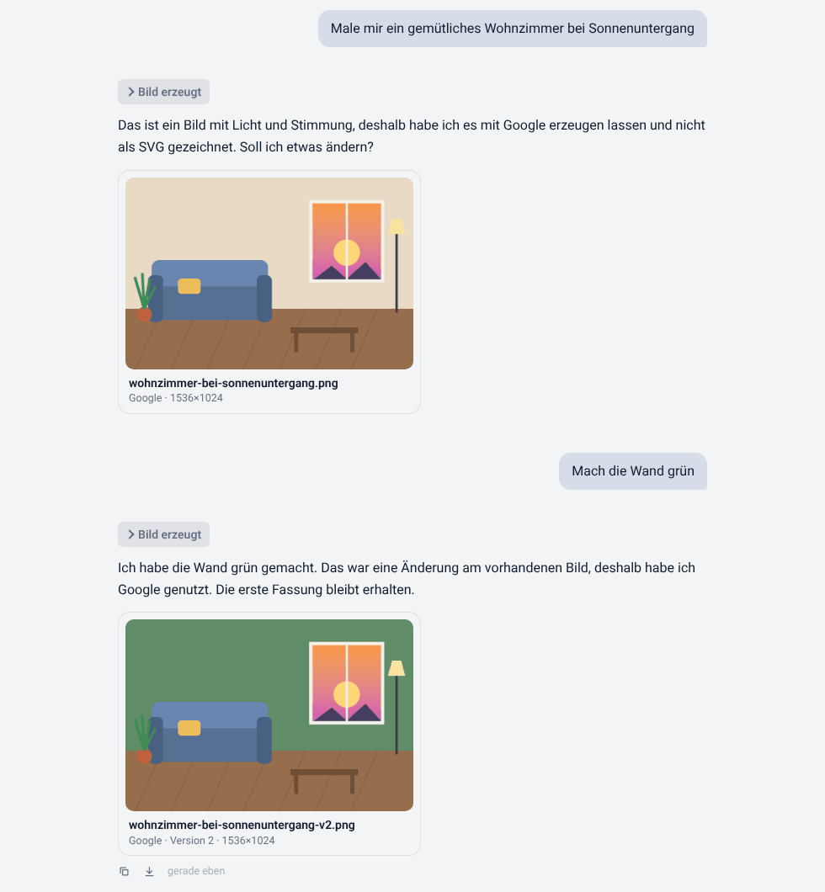

| | |
|---|---|
| 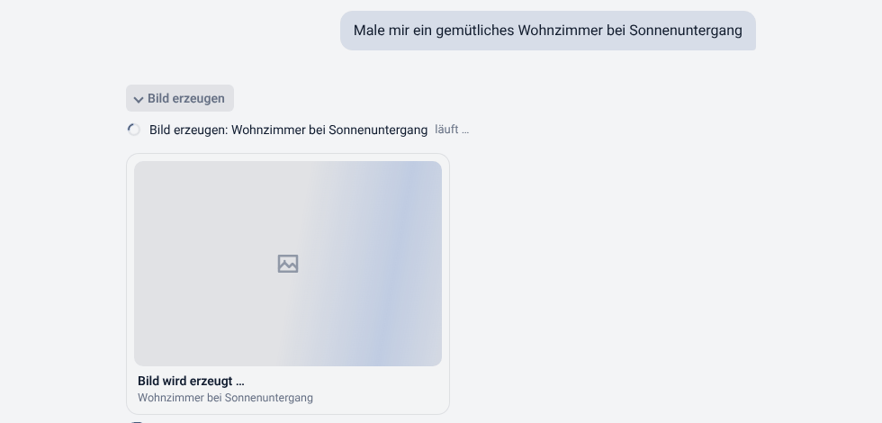 | 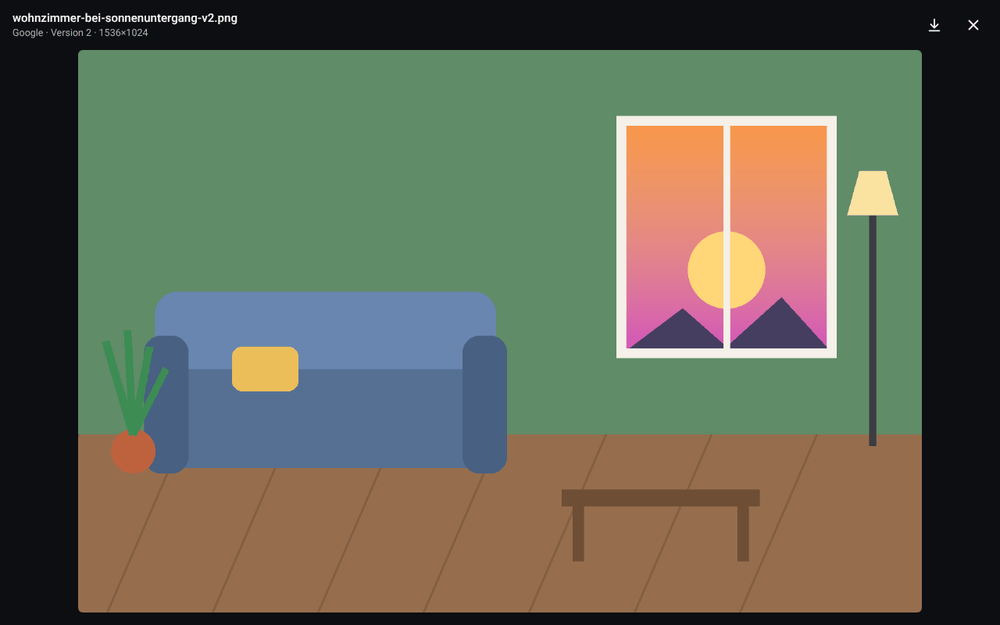 |

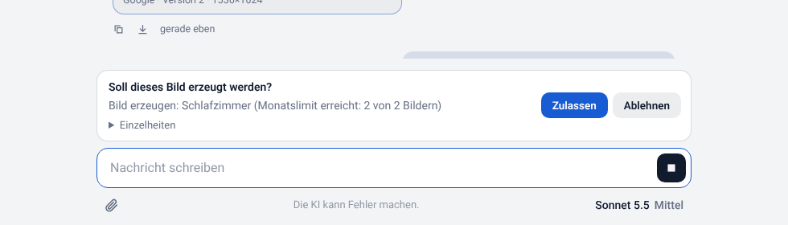

Mehr: [API-Konto und Schlüssel anlegen](bilder-konten.md), [Bilder (Einrichtung, Kosten, Datenschutz)](../copilot/DOCS.md#bilder-ab-0280).

## Geplante Aufgaben und Benachrichtigungen

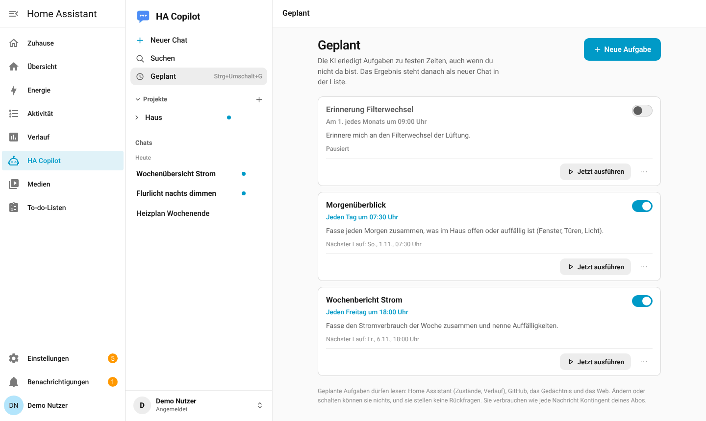

Unter **Geplant** legst du Aufgaben an, die die KI zu festen Zeiten erledigt (täglich, Montag bis Freitag, wöchentlich, monatlich, einmalig), zum Beispiel einen Morgenüberblick über das Haus. Sie dürfen **nur lesen**: Home Assistant, GitHub und Gedächtnis werden nie verändert. Das Ergebnis steht als ungelesener Chat in der Liste und optional als Meldung in Home Assistant oder aufs Handy (`notify_service` beim Benutzer).

Bleibt eine Antwort ungelesen, weil der Chat auf keinem Gerät offen ist, bekommt die Person eine Handy-Benachrichtigung (siehe „Benachrichtigung aufs Handy“ in der DOCS). `chat.schedules_enabled: false` schaltet die Seite ab.

Mehr: [Geplante Aufgaben](../copilot/DOCS.md#geplante-aufgaben-ab-0210).

## Aussehen und Sprache

- **Theme:** Im Home-Assistant-Panel übernimmt die App live die Farben und Hell/Dunkel von Home Assistant (`look.follow_ha_theme`). Über die Domain gilt das Standard-Theme oder ein eigenes (`look.theme_name`).
- **Name, Logo, Texte, Farben:** `look.app_name`, `look.login_text`, `look.login_placeholder`, die Farboptionen (`accent_color` …), eigene Dateien `logo.png`, `icon.png` und `custom.css` im Ordner `addon_config` des Add-ons. Eine eigene Seitenleisten-Beschriftung („HA Copilot“) steht dagegen fest in der Add-on-Konfiguration von Home Assistant.
- **Sprache:** `language: de` (Standard) oder `en`. Gilt für Oberfläche, Meldungen, Einrichtungsprüfung, Export und Benachrichtigungen.

| Home Assistant dunkel | Die App allein, hell | Die App allein, dunkel |
|---|---|---|
| 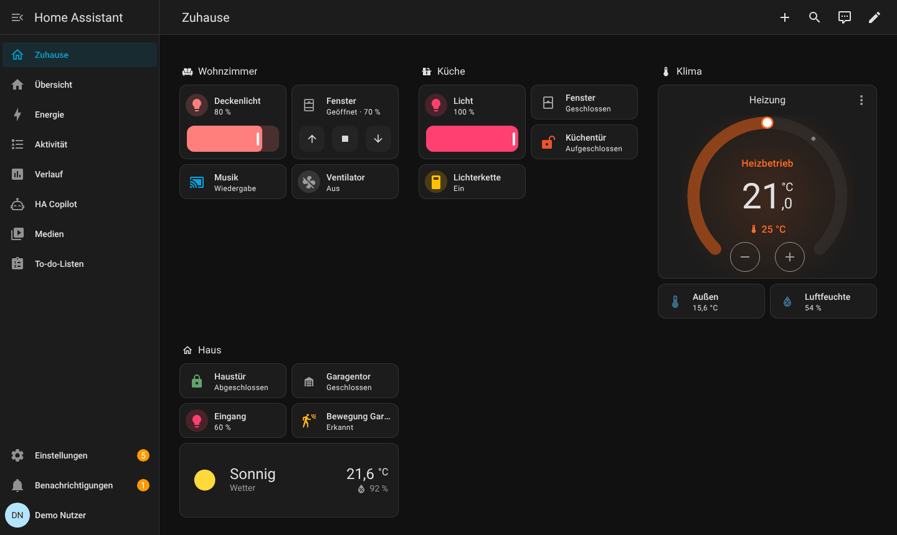 | 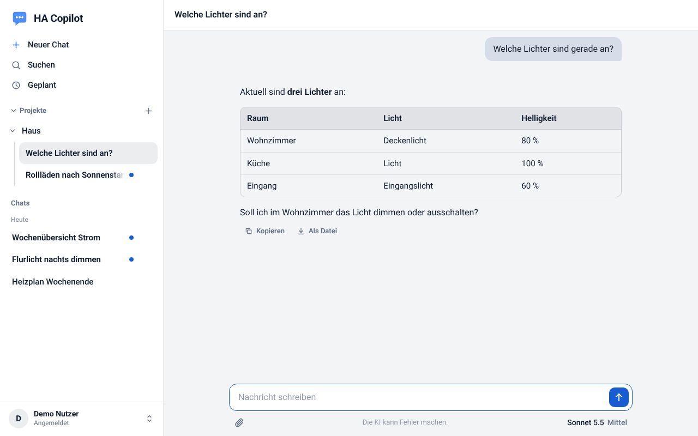 | 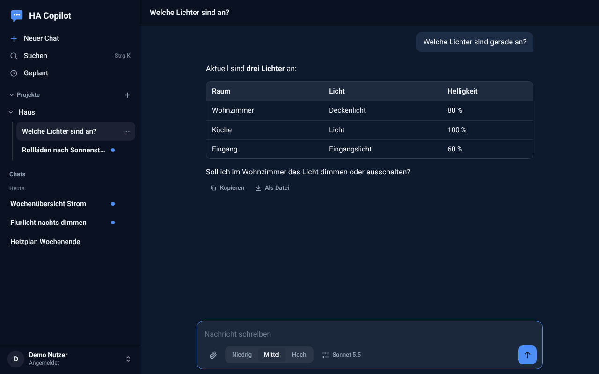 |

Mit einem eigenen Home-Assistant-Theme (hier „DORALAB“, nur Farben) übernimmt die App Akzent, Flächen und Schrift live, hell und dunkel:

| Eigenes Theme, hell | Eigenes Theme, dunkel |
|---|---|
| 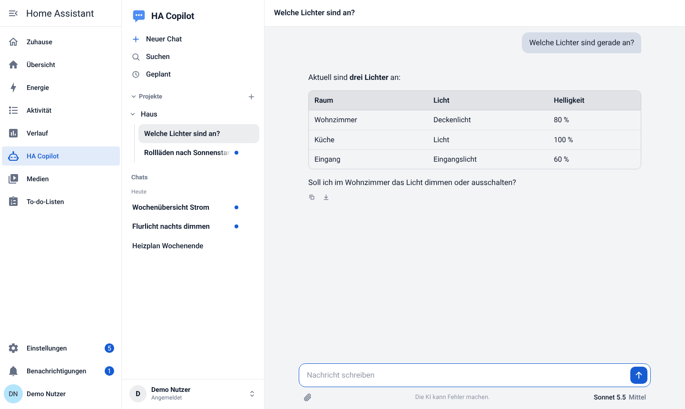 | 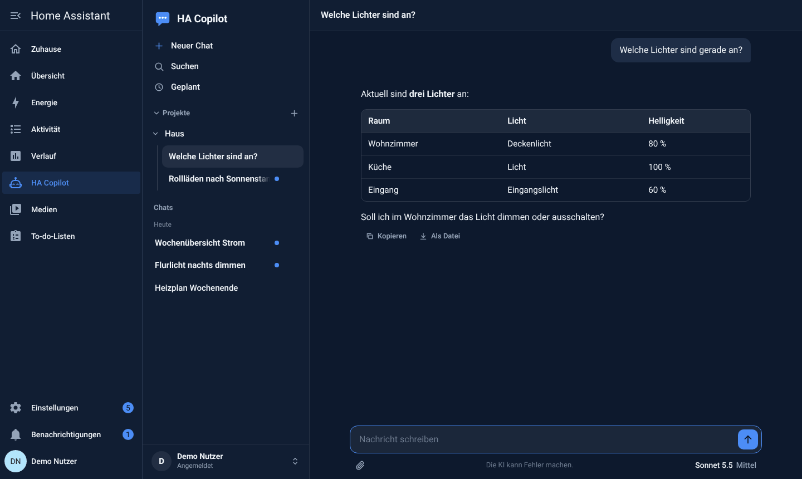 |

Englische Oberfläche (`language: en`):

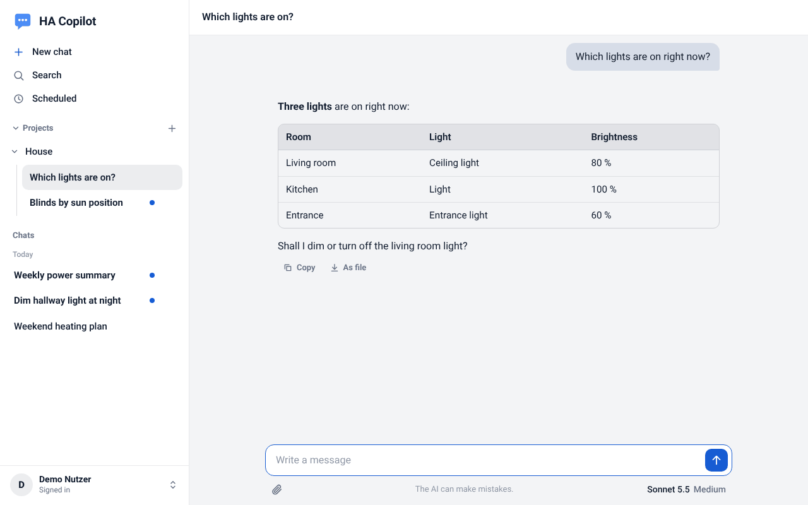

Mehr: [Personalisierung](../copilot/DOCS.md#personalisierung-name-logo-texte-farben), [Sprache](../copilot/DOCS.md#sprache-ab-0260).

## Auf dem Handy

Die Oberfläche passt sich dem Gerät an: Die Chat-Liste öffnet als Fenster von unten, Menüs werden zu Fenstern. Über die Domain lässt sich HA Copilot im Handy-Browser mit „Zum Home-Bildschirm“ als eigene App ablegen.

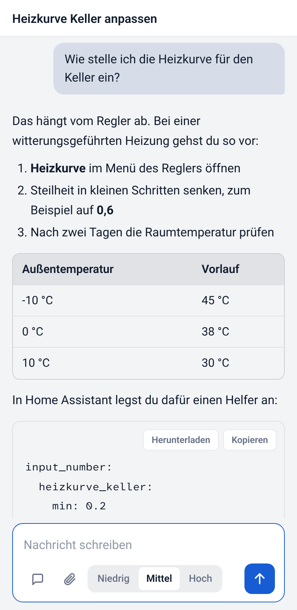

## Einrichtungsprüfung

In den **Einstellungen** zeigt die **Einrichtungsprüfung**, was fehlt, mit den genauen Schritten, und prüft Home Assistant, GitHub, den Benachrichtigungsdienst und die Sprach-Pipeline (welche Spracherkennung und Stimme gelten) live. Siehe [Installation](installation.md#6-einrichtungsprüfung).

## Sicherheit und Datenschutz

- Chats liegen in einer SQLite-Datenbank im Add-on-Speicher (Teil jeder HA-Sicherung). Texte deiner Nachrichten und Anhänge gehen zur Beantwortung an Anthropic; nur wenn du Bilder von OpenAI oder Google erzeugen lässt (eigene Schlüssel nötig), gehen der Bildwunsch und ein Referenzbild an den gewählten Anbieter, sonst an niemanden. Kopien von Anhängen (für das Bearbeiten) liegen für 14 Tage im Datenordner des Add-ons und verschwinden mit dem Chat.
- Jede Abfrage ist auf das Profil gefiltert; Benutzer sehen nie die Chats anderer.
- Rechte setzt der Server durch, nicht die KI. Alles, was von außen kommt (Home Assistant, Web, GitHub, Konnektoren, Dateien), gilt für die KI als Information und nicht als Anweisung; nach dem Lesen fremder Inhalte fragt jede Änderung im Chat nach.
- Die Domain-Anmeldung prüft die Identität serverseitig (OpenID Connect mit PKCE), Sitzungen liegen serverseitig, Cookies sind `Secure` und `HttpOnly`.

Mehr: [Sicherheit in Kürze](../copilot/DOCS.md#sicherheit-in-kürze), [SECURITY.md](../SECURITY.md).
