# Funktionen

Ein Überblick über alles, was HA Copilot kann, mit den Einstellungen, die dazugehören. Jeder Abschnitt verweist auf die ausführliche Beschreibung in der [Add-on-Dokumentation](../ki_chat/DOCS.md). Alle Optionen mit Standardwerten stehen in [Alle Einstellungen](einstellungen.md).

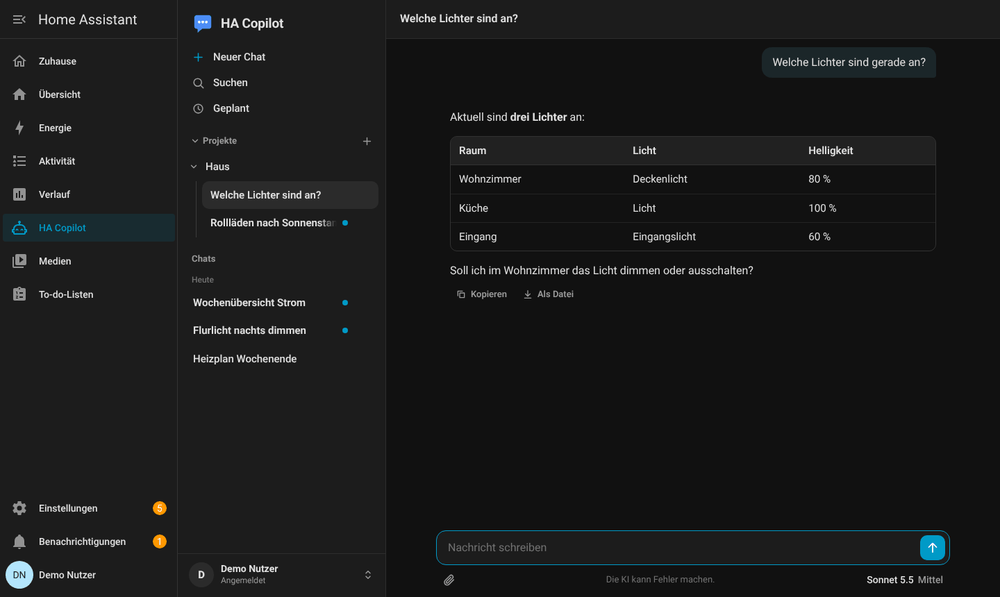

## Chat

- Antworten erscheinen als **Live-Stream** mit Markdown, Tabellen und Codeblöcken (Kopieren, Herunterladen). Vollständige HTML-Seiten bekommen eine **Vorschau**, die abgeschottet und ohne Netzwerk läuft.
- **Antworten laufen auf dem Server weiter.** Du kannst den Chat wechseln, die Seite neu laden oder den Tab schließen; die Antwort wird trotzdem fertig und steht danach als ungelesen in der Liste. Mit „Stopp“ brichst du sie ab.
- Pro Nachricht lässt sich die **Denktiefe** wählen (Niedrig, Mittel, Hoch), dazu das **Modell** (Einstellung `models`) und die **Websuche**. Alles steht in einem Menü (Knopf z. B. „Sonnet 5.5 Mittel“; am Computer rechts unter dem Eingabefeld, am Handy im Eingabefeld neben der Büroklammer), wie in Claude: gewähltes Modell, „Aufwand“ und „Weitere Modelle“ als Untermenüs.
- **Anhänge** (bis zu 5 je Nachricht, zusammen 60 MB): Bilder, PDF, Word, Excel, PowerPoint, Text und Code. Mit der Option „Dateien bearbeiten“ (Standard) bleibt eine Kopie für diesen Chat erhalten, damit die KI die Datei später lesen und **bearbeiten** kann (z. B. PDF-Felder sperren, Word-Text ändern, Excel-Zellen setzen, Code anpassen); die bearbeitete Fassung gibt es als Download, das Original bleibt unverändert. Ohne die Option gibt es die Anhänge nur im Arbeitsspeicher. Einfügen mit Strg/Cmd+V oder Ziehen auf die Seite geht auch.
- **Nachrichten bearbeiten:** Unter jeder eigenen Nachricht erscheint beim Darüberfahren, wann sie gesendet wurde („vor 33 Minuten“, „vor 2 Stunden“, „Heute Morgen“, „Gestern“, „Vorgestern“, „vor 3 Tagen“, ab einer Woche das Datum), dazu **Bearbeiten** (Stift) und **Kopieren**. Beim Bearbeiten ersetzt die neue Frage die alte und alles danach in diesem Chat; scheitert die neue Antwort, bleibt der alte Verlauf erhalten. Dateien der alten Frage müssen neu angehängt werden.

| Zeitpunkt, Bearbeiten, Kopieren | Nachricht bearbeiten |
|---|---|
| 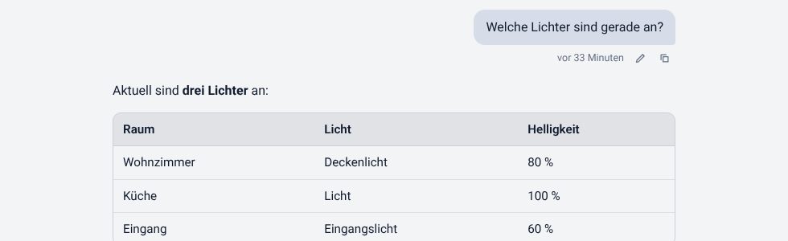 | 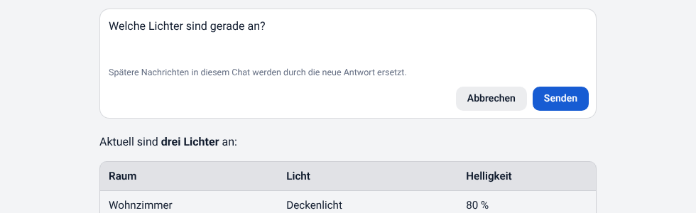 |

- Lange Chats werden **automatisch zusammengefasst**, statt abgeschnitten zu werden.
- Ein kurzer **Titel** entsteht automatisch (`title_model`), und jeder Chat lässt sich umbenennen.

Mehr: [Oberfläche](../ki_chat/DOCS.md#oberfläche), [So arbeitet die KI](../ki_chat/DOCS.md#so-arbeitet-die-ki), [Dateien bearbeiten](../ki_chat/DOCS.md#dateien-bearbeiten-ab-0270), [Anhänge und Speicherplatz](../ki_chat/DOCS.md#anhänge-und-speicherplatz).

## Projekte, Suche, Export

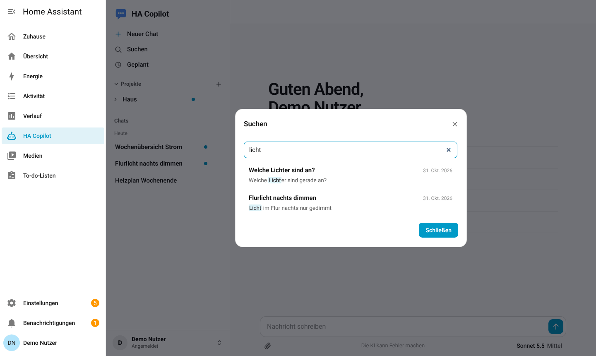

- **Projekte** ordnen Chats und tragen **Anweisungen** (bis 4000 Zeichen), die in jedem Chat des Projekts mitgehen. Zu einem Projekt kannst du **Wissen** hochladen (Notizen, Word, Excel, PDF, ZIP); die KI liest bei Bedarf nach.
- **Suchen** (Strg/Cmd+Umschalt+F) durchsucht Titel und Nachrichten aller deiner Chats, ohne Rücksicht auf Groß- und Kleinschreibung und Umlaute.
- **Tastenkürzel** am Computer: Strg (Mac: ⌘) + Umschalt + **O** neuer Chat, **F** Suchen, **P** neues Projekt, **G** geplante Aufgaben. Das Kürzel steht in der Seitenleiste erst, wenn du mit der Maus über den Eintrag fährst.
- **Hinweise über dem Eingabefeld:** Nutzungslimit und Rückfragen der KI (z. B. vor einer Änderung in Home Assistant) erscheinen als Streifen direkt über dem Eingabefeld, wie in Claude selbst, jeweils als eigene schmale Box (nicht am Eingabefeld angebaut).
- Anpinnen, umbenennen, in ein Projekt verschieben, als Markdown exportieren, löschen: alles im Menü (⋯) jeder Zeile.

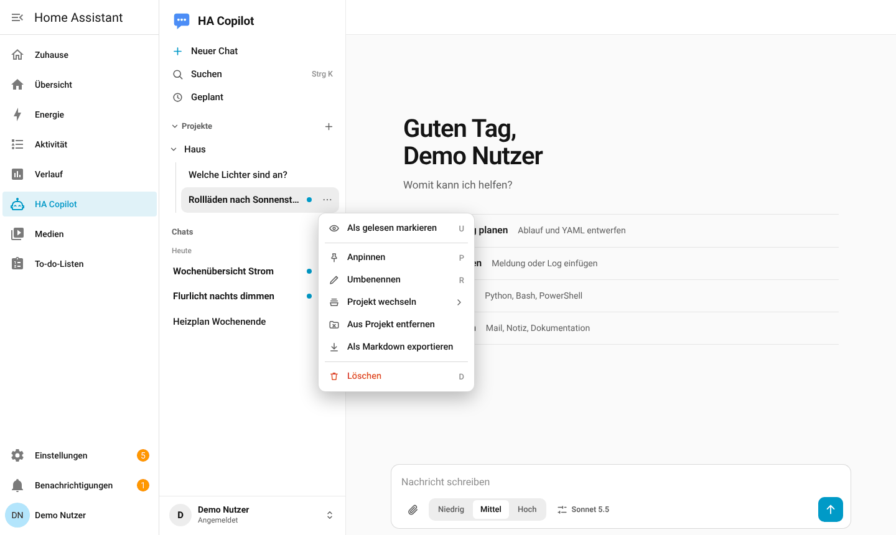

- Unter **Meine Daten** (Konto-Menü) exportierst du alle Chats als ZIP oder löschst sie unwiderruflich.

Mehr: [Suche, Export und eigene Daten](../ki_chat/DOCS.md#suche-export-und-eigene-daten-ab-0220).

## Zugriff auf Home Assistant

Die KI kann Home Assistant benutzen: Zustände ansehen, Verlauf und Logbuch lesen, Geräte schalten und, mit der höchsten Stufe, Automationen, Skripte, Szenen, Dashboards und Helfer bauen. Beispiele:

- „Welche Lichter sind gerade an?“
- „Schalte das Wohnzimmer aus.“
- „Lege eine Szene für den Abend an.“
- „Warum ging die Automation ‚Flurlicht‘ gestern nicht an?“

Was erlaubt ist, hängt von der **Stufe je Benutzer** ab (`none`, `read`, `execute`, `write`, siehe [Benutzer und Rechte](benutzer.md#rechte-der-ki)). Änderungen fragen im Chat nach (`ha_write_confirm`), Schlösser, Alarmanlagen und Garagentore **immer**. Neustart, Updates, Sicherungen und Benutzerverwaltung sind **nie** möglich. Unter jeder Antwort steht einklappbar, was die KI in Home Assistant getan hat. Vor jeder Änderung an Automationen, Skripten, Szenen und Dashboards sichert das Add-on die alte Fassung (die letzten 60).

Standardmäßig sieht und bedient die KI nur Entitäten, die du in Home Assistant für Assist freigegeben hast (`ha_limit_to_exposed`).

Mehr: [Zugriff auf Home Assistant](../ki_chat/DOCS.md#zugriff-auf-home-assistant-ab-0150), [Smarthome-Überblick](../ki_chat/DOCS.md#smarthome-überblick-ab-0170).

## Gedächtnis

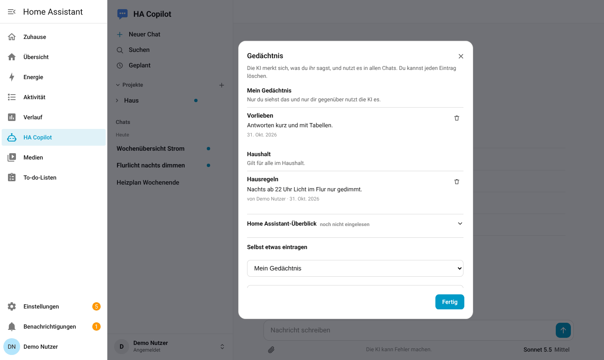

Die KI merkt sich dauerhafte Dinge in kurzen Einträgen, getrennt in **Haushalt** (für alle) und **Person** (nur du). Du siehst, ergänzt und löschst Einträge im Konto-Menü unter **Gedächtnis**. Wer in den Haushalt schreiben darf, regelt `memory_household_writers`. Mit `memory_enabled: false` ist die Funktion aus.

Zusätzlich liest das Add-on selbst einen **Smarthome-Überblick** (Bereiche, Entitäten je Typ, Integrationen, Namen von Automationen) ein und legt ihn als schreibgeschützte Einträge ab. Das kostet keine KI-Nachricht. `ha_scan_days: 0` schaltet es ab.

Mehr: [Projektwissen und Gedächtnis](../ki_chat/DOCS.md#projektwissen-und-gedächtnis-ab-0160).

## GitHub

Mit einem GitHub-Token (`github_token`) arbeitet die KI mit deinen Repositories: lesen, Code durchsuchen, Issues und Pull Requests ansehen, und mit Schreibrecht Dateien einchecken, Zweige und Pull Requests anlegen. Jede Änderung wird im Chat bestätigt; Commits auf den Hauptzweig, Workflow-Dateien und das Mergen immer. Mit `github_repos` beschränkst du die KI auf bestimmte Repositories.

Einrichtung in vier Schritten:

1. Bei GitHub unter *Settings → Developer settings → Personal access tokens → Fine-grained tokens* ein Token erzeugen, nur für die gewünschten Repositories. Rechte: *Contents*, *Pull requests*, *Issues* je Read and write (zum bloßen Lesen Read-only), *Actions* Read-only, *Metadata* Read-only.
2. Das Token bei `github_token` eintragen.
3. Bei den Benutzern `github_access` (oder `github_access_default`) auf `read` oder `write` setzen. Standard ist `none`.
4. Speichern, Add-on neu starten.

Mehr: [GitHub](../ki_chat/DOCS.md#github-ab-0190).

## Websuche und Modelle

- Die KI sucht im Web und liest Seiten, wenn es nötig ist oder du darum bittest. Pro Benutzer steuerbar (`web_access`, `web_access_default`). Seiten aus dem Heimnetz und interne Adressen werden nie geladen.
- `model` ist das Standardmodell, `models` legt fest, welche weiteren im Chat wählbar sind.
- Ist ein Limit deines Abos fast erreicht, erscheint oben im Chat ein Hinweis mit der Zeit der Rücksetzung.

Mehr: [Web, Modell und Nutzungslimit](../ki_chat/DOCS.md#web-modell-und-nutzungslimit-ab-0200).

## Dateien erzeugen

Auf Wunsch legt die KI **Word, Excel, PowerPoint, PDF** und Skripte (PowerShell, Shell, Python …) an. Unter der Antwort erscheint eine Karte mit Download. Die Dateien bleiben `files_keep_days` Tage (Standard 14) und gehören nur dir. Abschalten mit `files_enabled: false`.

Mehr: [Dateien erzeugen](../ki_chat/DOCS.md#dateien-erzeugen-ab-0180).

## Geplante Aufgaben und Benachrichtigungen

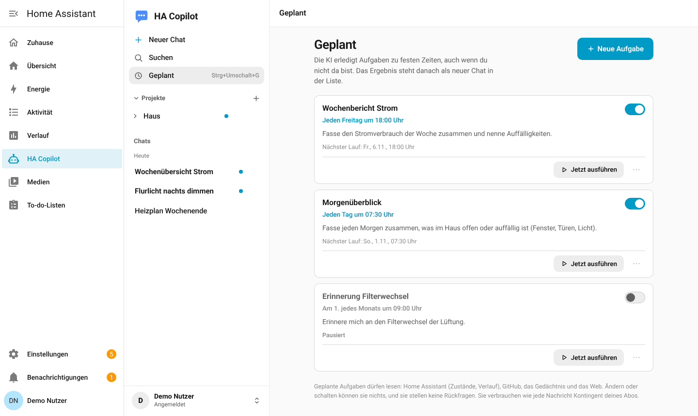

Unter **Geplant** legst du Aufgaben an, die die KI zu festen Zeiten erledigt (täglich, Montag bis Freitag, wöchentlich, monatlich, einmalig), zum Beispiel einen Morgenüberblick über das Haus. Sie dürfen **nur lesen**: Home Assistant, GitHub und Gedächtnis werden nie verändert. Das Ergebnis steht als ungelesener Chat in der Liste und optional als Meldung in Home Assistant oder aufs Handy (`notify_service` beim Benutzer).

Dauert eine normale Antwort länger als etwa 45 Sekunden und niemand sieht mehr zu, bekommt die Person ebenfalls eine Handy-Benachrichtigung (`notify_long_answers`). `schedules_enabled: false` schaltet die Seite ab.

Mehr: [Geplante Aufgaben](../ki_chat/DOCS.md#geplante-aufgaben-ab-0210).

## Aussehen und Sprache

- **Theme:** Im Home-Assistant-Panel übernimmt die App live die Farben und Hell/Dunkel von Home Assistant (`follow_ha_theme`). Über die Domain gilt das Standard-Theme oder ein eigenes (`theme_name`).
- **Name, Logo, Texte, Farben:** `app_name`, `login_text`, `login_placeholder`, die Farboptionen (`accent_color` …), eigene Dateien `logo.png`, `icon.png` und `custom.css` im Ordner `addon_config` des Add-ons. Eine eigene Seitenleisten-Beschriftung („HA Copilot“) steht dagegen fest in der Add-on-Konfiguration von Home Assistant.
- **Sprache:** `language: de` (Standard) oder `en`. Gilt für Oberfläche, Meldungen, Einrichtungsprüfung, Export und Benachrichtigungen.

| Home Assistant dunkel | Die App allein, hell | Die App allein, dunkel |
|---|---|---|
| 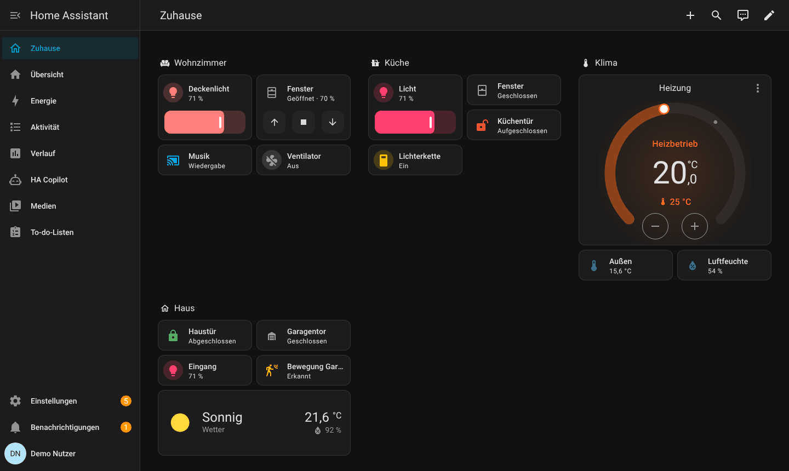 | 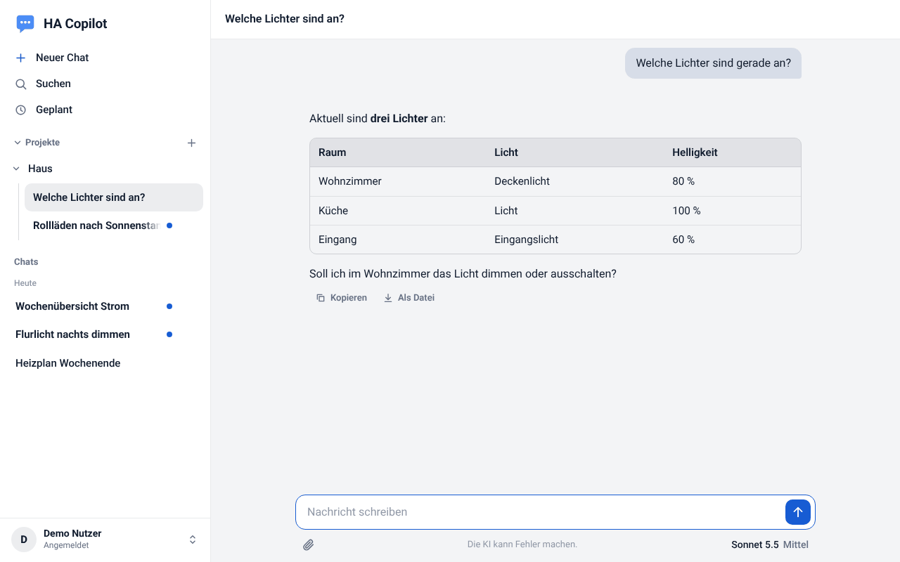 | 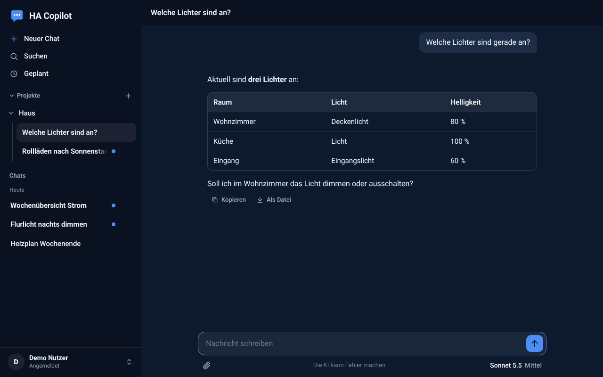 |

Mit einem eigenen Home-Assistant-Theme (hier „DORALAB“, nur Farben) übernimmt die App Akzent, Flächen und Schrift live, hell und dunkel:

| Eigenes Theme, hell | Eigenes Theme, dunkel |
|---|---|
| 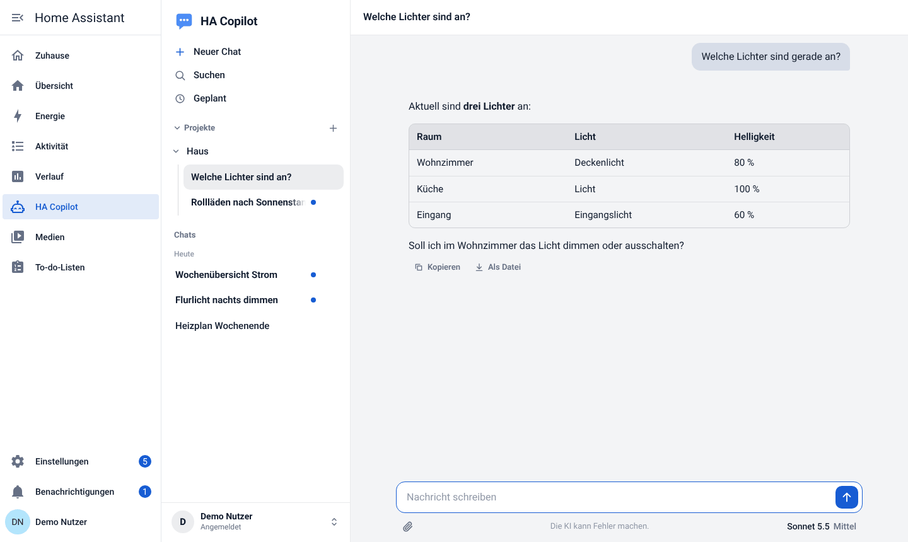 | 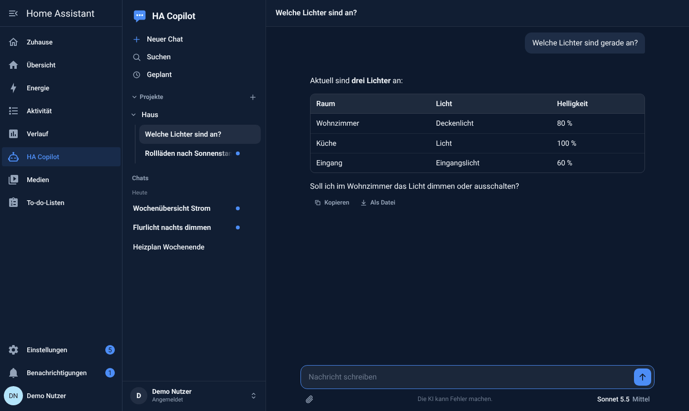 |

Englische Oberfläche (`language: en`):

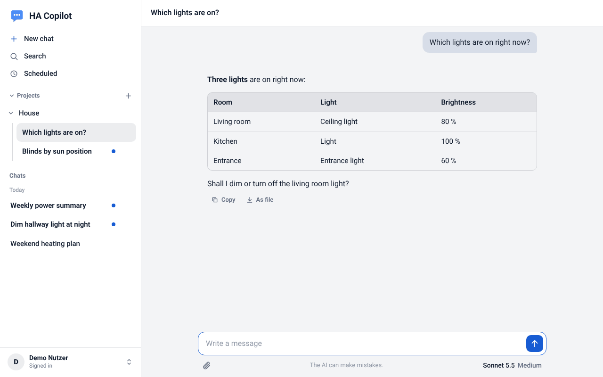

Mehr: [Personalisierung](../ki_chat/DOCS.md#personalisierung-name-logo-texte-farben), [Sprache](../ki_chat/DOCS.md#sprache-ab-0260).

## Auf dem Handy

Die Oberfläche passt sich dem Gerät an: Die Chat-Liste öffnet als Fenster von unten, Menüs werden zu Fenstern. Über die Domain lässt sich HA Copilot im Handy-Browser mit „Zum Home-Bildschirm“ als eigene App ablegen.

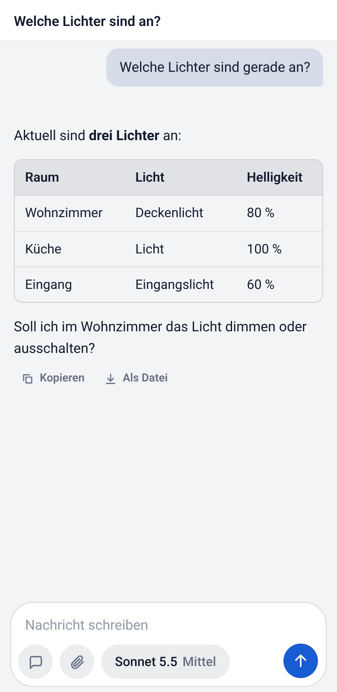

## Einrichtungsprüfung

Im Konto-Menü zeigt die **Einrichtungsprüfung**, was fehlt, mit den genauen Schritten, und prüft Home Assistant, GitHub und den Benachrichtigungsdienst live. Siehe [Installation](installation.md#6-einrichtungsprüfung).

## Sicherheit und Datenschutz

- Chats liegen in einer SQLite-Datenbank im Add-on-Speicher (Teil jeder HA-Sicherung). Texte deiner Nachrichten und Anhänge gehen zur Beantwortung an Anthropic, sonst an niemanden. Kopien von Anhängen (für das Bearbeiten) liegen für `files_keep_days` Tage im Datenordner des Add-ons und verschwinden mit dem Chat.
- Jede Abfrage ist auf das Profil gefiltert; Benutzer sehen nie die Chats anderer.
- Rechte setzt der Server durch, nicht die KI. Alles, was von außen kommt (Home Assistant, Web, GitHub, Dateien), gilt für die KI als Information und nicht als Anweisung; nach dem Lesen fremder Inhalte fragt jede Änderung im Chat nach.
- Die Domain-Anmeldung prüft die Identität serverseitig (OpenID Connect mit PKCE), Sitzungen liegen serverseitig, Cookies sind `Secure` und `HttpOnly`.

Mehr: [Sicherheit in Kürze](../ki_chat/DOCS.md#sicherheit-in-kürze), [SECURITY.md](../SECURITY.md).
