# Funktionen

Ein Überblick über alles, was HA Copilot kann, mit den Einstellungen, die dazugehören. Jeder Abschnitt verweist auf die ausführliche Beschreibung in der [Add-on-Dokumentation](../copilot/DOCS.md). Alle Optionen mit Standardwerten stehen in [Alle Einstellungen](einstellungen.md).

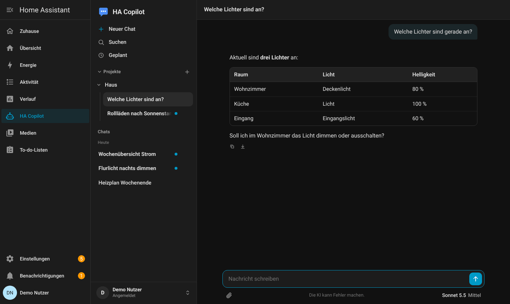

## Chat

- Antworten erscheinen als **Live-Stream** mit Markdown, verschachtelten Stichpunkten, Tabellen und Codeblöcken (kompakt, mit Knöpfen zum Kopieren und Herunterladen, schon während die Antwort läuft). Vollständige HTML-Seiten bekommen eine **Vorschau**, die abgeschottet und ohne Netzwerk läuft.
- **Antworten laufen auf dem Server weiter.** Du kannst den Chat wechseln, die Seite neu laden oder den Tab schließen; die Antwort wird trotzdem fertig und steht danach als ungelesen in der Liste. Mit „Stopp“ brichst du sie ab.
- **Aktionen der KI in einer Zeile (wie in Claude):** Über der Antwort steht, was die KI getan hat, als eine ruhige Zeile mit Pfeil („3 Aktionen in Home Assistant, davon 1 Änderung“). Ein Klick klappt jeden einzelnen Schritt auf. Auch **während** der Antwort bleibt die Liste zu: Im Chat siehst du nur die Aktion, die gerade läuft. Schlägt etwas fehl, steht dort in Rot „nicht ausgeführt“.

| Aktionen zusammengefasst | Aufgeklappt |
|---|---|
| 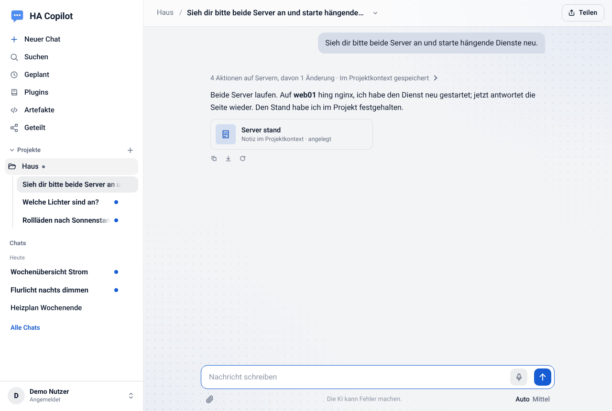 | 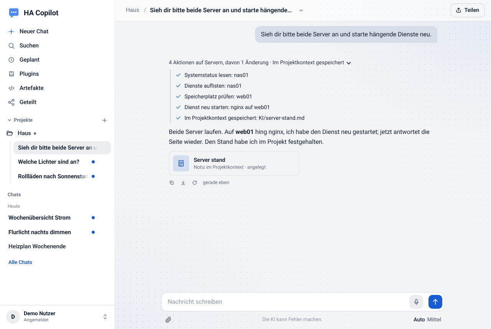 |

- Pro Nachricht lässt sich die **Denktiefe** wählen (Niedrig, Mittel, Hoch), dazu das **Modell** und die **Websuche**. Alles steht in einem Menü (Knopf z. B. „Sonnet 5.5 Mittel“; am Computer rechts unter dem Eingabefeld, am Handy im Eingabefeld neben der Büroklammer), wie in Claude: gewähltes Modell, „Aufwand“ und „Weitere Modelle“ als Untermenüs.
- **Listen schreiben:** `1. ` oder `- ` am Zeilenanfang wird eingerückt, Umschalt+Enter (am Handy Enter) führt die Liste fort, ein leerer Punkt beendet sie, Tab rückt ein. Gesendet erscheint sie als Liste.
- **Modell im laufenden Chat wechseln:** geht jederzeit, auch zwischen Claude und ChatGPT. Der Verlauf geht mit, Gedächtnis, Projektwissen und Konnektoren bleiben; die Oberfläche sagt, wohin der Verlauf dann geht.
- **Inkognito-Chat:** Das Gespenster-Symbol neben „Neuer Chat“ öffnet einen Chat, in dem nichts zurückbleibt: kein Gedächtnis, nicht in der Liste oder Suche, kein Export, keine Sicherung. Beim Verlassen wird er samt Dateien gelöscht. Die KI sagt, wenn du sie bittest, sich etwas zu merken, dass das hier nicht geht.
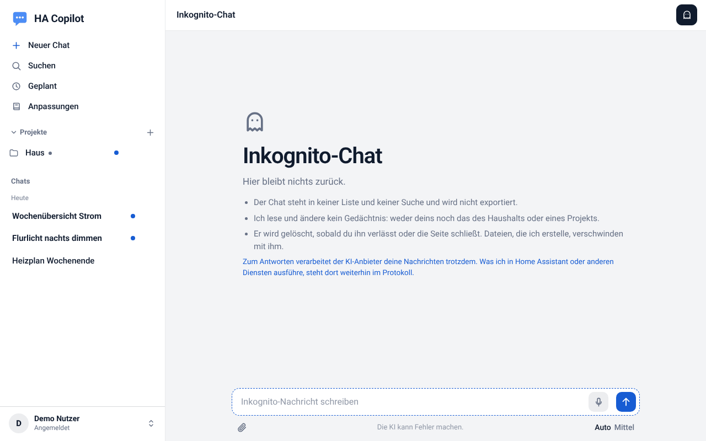

- **Kopfzeile wie in Claude:** Über dem Chat steht **Projekt / Chatname ▾**: Klick auf den Namen = umbenennen, Pfeil = Chat-Menü, rechts der Knopf **Teilen**.
- **Chats teilen:** Im Fenster **Chat teilen** wählst du unter **Wer hat Zugriff**: einen Link nur für Personen dieser Instanz (wer ihn öffnet, findet den Chat unter **Geteilt**, du siehst unter **Geöffnet von**, wer das war) oder einen Link für jede Person (ohne Anmeldung, nur lesen; `chat.sharing: public`). Das Zwischenablage-Symbol im Linkfeld kopiert ihn, die Gültigkeit (7 Tage, 30 Tage, unbegrenzt) stellst du direkt im Fenster ein, der rote Knopf **Teilen beenden** unten nimmt alles zurück (mit Rückfrage). Geteilte Chats tragen in der Liste ein kleines Symbol; **Geteilt** steht immer in der Seitenleiste (mit mir und von mir, mit rotem Mülleimer zum Entfernen). Geteilt wird ein Schnappschuss ohne Anhänge und Protokoll.
- **Deep Research** (optional, Standard aus): Im Menü unter dem Eingabefeld lässt sich für die nächste Nachricht eine **Tiefenrecherche** einschalten: Die KI plant, sucht in mehreren Runden im Web, gleicht die Funde ab und schreibt einen Bericht mit geprüfter Quellenliste. Vorher fragt der Chat nach, weil ein Lauf mehrere Minuten dauert und viel Kontingent braucht (`chat.research_enabled`, `chat.research_daily_limit`).
| Teilen-Fenster | Öffentliche Seite | „Geteilt“ einer anderen Person |
|---|---|---|
| 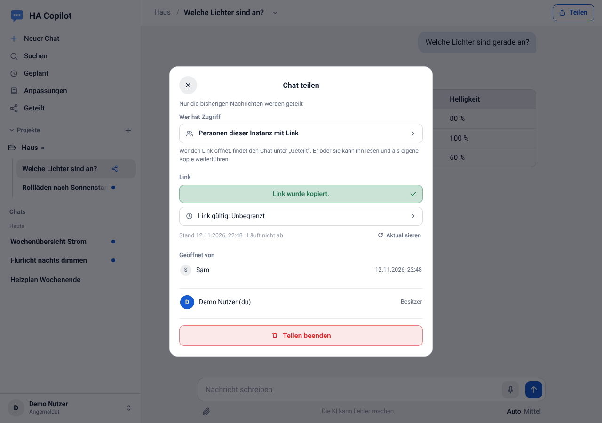 | 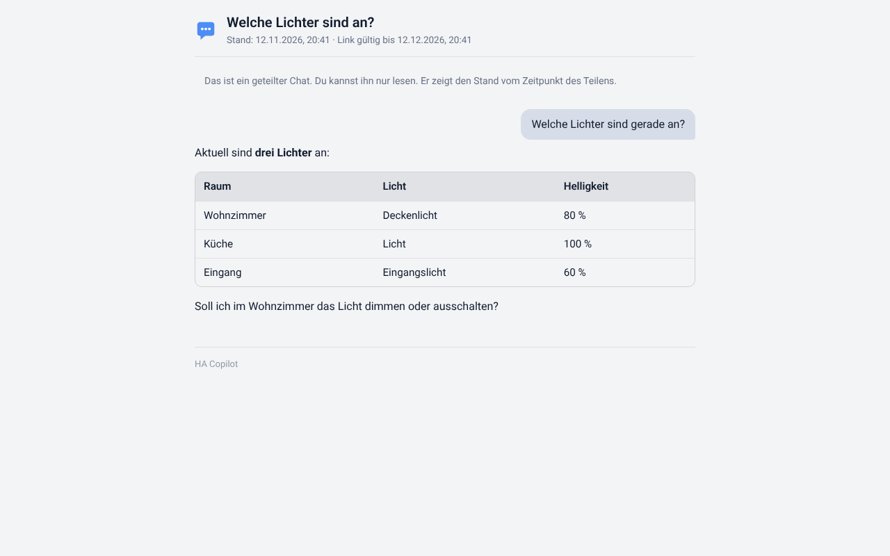 | 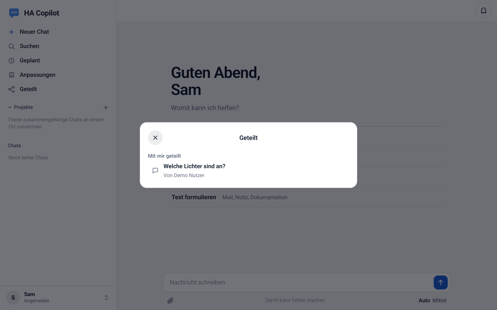 |

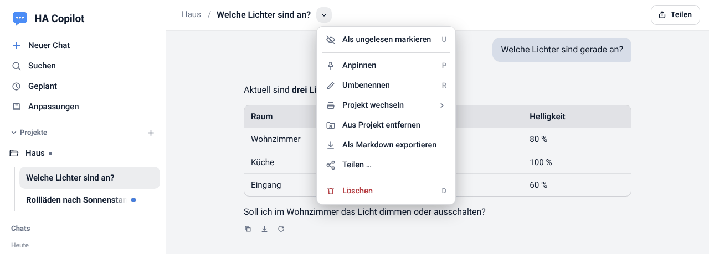

| Deep Research einschalten | Rückfrage vor dem Start | Bericht mit Quellen |
|---|---|---|
| 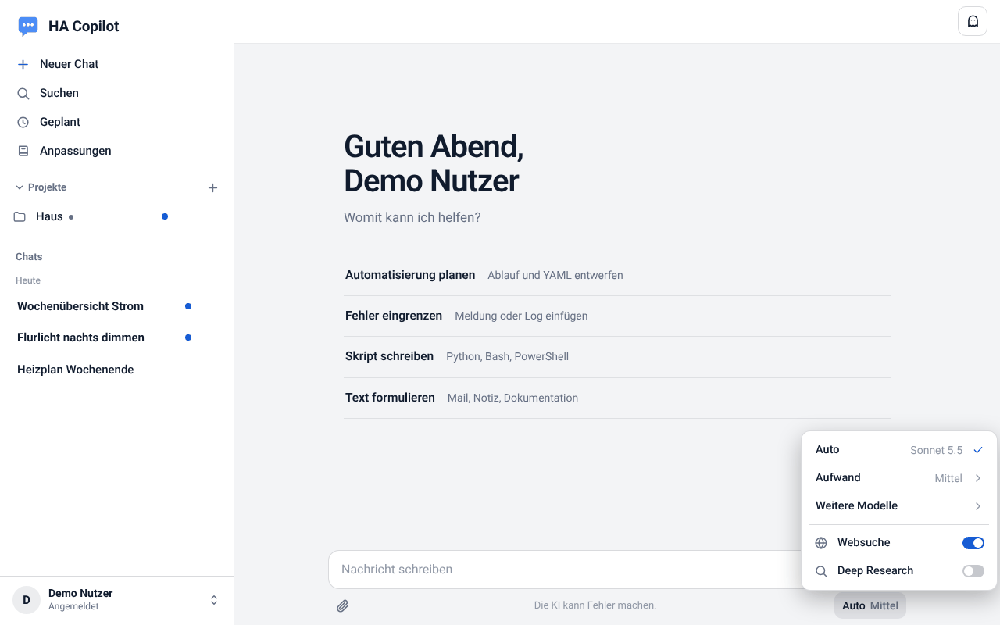 | 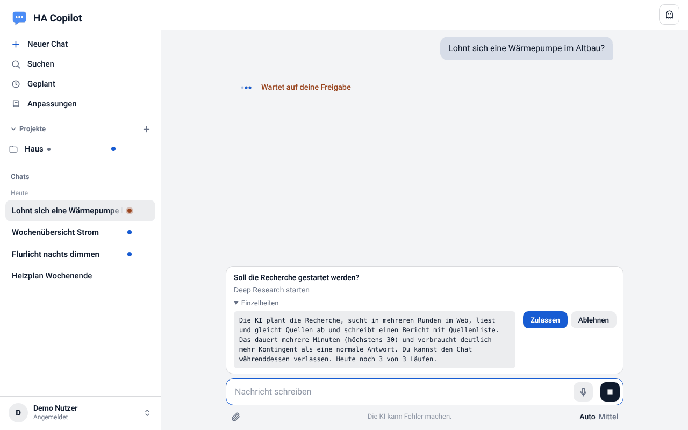 | 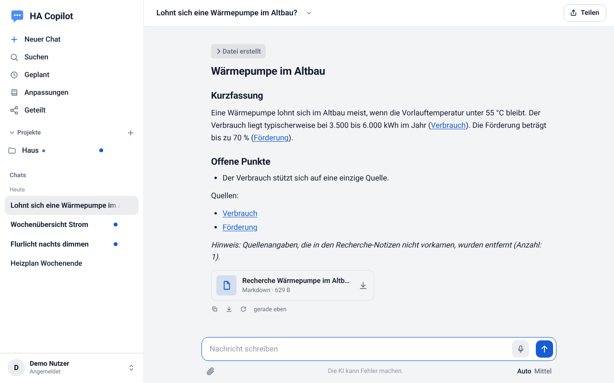 |

- **Anhänge** (bis zu 5 je Nachricht, zusammen 60 MB): Bilder, PDF, Word, Excel, PowerPoint, Text und Code. Mit der Option „Dateien bearbeiten“ (Standard) bleibt eine Kopie für diesen Chat erhalten, damit die KI die Datei später lesen und **bearbeiten** kann (z. B. PDF-Felder sperren, PDF-Text ersetzen, Word-Text ändern, Excel-Zellen setzen, Code anpassen; Excel-Diagramme und -Bilder bleiben dabei erhalten); die bearbeitete Fassung gibt es als Download, das Original bleibt unverändert. Ohne die Option gibt es die Anhänge nur im Arbeitsspeicher. Einfügen mit Strg/Cmd+V oder Ziehen auf die Seite geht auch. **Langer Text** (ab etwa 1500 Zeichen oder 20 Zeilen), den du einfügst, wird wie in Claude automatisch ein Anhang („Eingefügter Text“) statt Rohtext im Eingabefeld; du kannst ihn im Chat antippen und die KI sieht ihn auch bei Folgefragen.
- **Auf einen Ausschnitt antworten:** Text in einer Antwort markieren und **Antworten** wählen: der Ausschnitt steht als Zitat über dem Eingabefeld (mit **x** wieder entfernbar) und über deiner Nachricht im Chat. Die KI bekommt das Zitat mit.
- **Einführung und Neuerungen:** Beim ersten Anmelden erklärt ein Fenster („Hallo, ich bin …“), wofür die KI da ist, was sie kann und wie man sie am Computer oder am Handy bedient; mit **Okay** erscheint es nie wieder. Nach einem Update zeigt ein Fenster einmalig, was neu ist, in einfacher Sprache. Beides lässt sich im Konto-Menü unten links nachlesen (**Kurzanleitung**, **Das ist neu**).
- **Einstellungen und Konto-Menü:** Unten links (mit deinem Profilbild aus Home Assistant, sonst dem Anfangsbuchstaben) öffnet das Konto-Menü **Einstellungen**, **Nutzung**, die **Einrichtungsprüfung** (in Home Assistant) und **Abmelden** (Domain); auf dem Handy öffnet der Tipp auf den Namen gleich die Einstellungen (Abmelden steht dort unten). Am Laptop und Tablet öffnen die Einstellungen als großes Fenster über dem Chat (wie bei Claude), auf dem Handy als eigene Seite. Darin (Liste links) stehen Allgemein (Design), Nutzung (Balken für Sitzungs- und Wochenlimit mit Rücksetzzeit, ChatGPT-Token und Bilder im Monat samt geschätzten Kosten, für alle Personen gleich und mit automatischer Aktualisierung; mit Claude-Abo zusätzlich der Knopf „Jetzt prüfen“), Gedächtnis, GitHub, Meine Daten und Hilfe. Plugins, Konnektoren und Skills stehen gemeinsam unter **Plugins** in der Seitenleiste. Nach dem Neuladen bleibst du auf der Seite, auf der du warst. Mehr: [Einstellungen](../copilot/DOCS.md#einstellungen-und-konto-menü-ab-0481).
- **Nachrichten bearbeiten:** Unter jeder eigenen Nachricht erscheint beim Darüberfahren, wann sie gesendet wurde („vor 33 Minuten“, „vor 2 Stunden“, „Heute Morgen“, „Gestern“, „Vorgestern“, „vor 3 Tagen“, ab einer Woche das Datum), dazu **Bearbeiten** (Stift) und **Kopieren**. Beim Bearbeiten ersetzt die neue Frage die alte und alles danach in diesem Chat; scheitert die neue Antwort, bleibt der alte Verlauf erhalten. Dateien der alten Frage müssen neu angehängt werden.
- **Unter den Antworten der KI** stehen **Kopieren** und **Als Datei** als dezente Symbole, bei der letzten Antwort dauerhaft, bei älteren beim Darüberfahren. Dort erscheint dann auch, wann die Antwort fertig wurde.

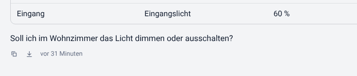

| Zeitpunkt, Bearbeiten, Kopieren | Nachricht bearbeiten |
|---|---|
| 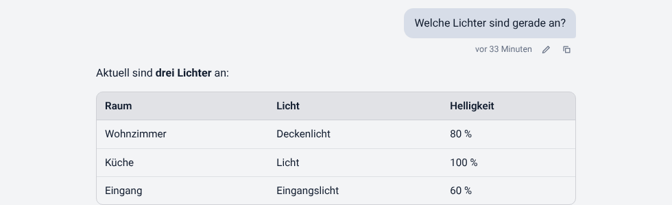 | 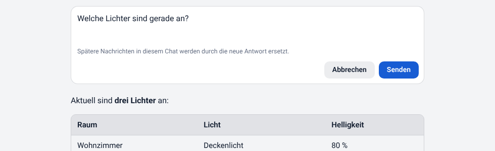 |

- **Wie in Claude:** Unter der letzten Antwort gibt es **Antwort neu erzeugen** (bei Nachrichten ohne Dateianhang), ein runder **Pfeil nach unten** springt ans Ende des Chats, und Codeblöcke zeigen ihre Sprache als kleine Marke.
- **Lange Antworten** bleiben beim Entstehen mit ihrem Anfang oben im Bild stehen: Du liest von vorn, der Chat springt weder mit noch am Ende nach unten. Scrollst du selbst, wird dir das nicht aus der Hand genommen.
- Lange Chats werden **automatisch zusammengefasst**, statt abgeschnitten zu werden.
- Ein kurzer **Titel** entsteht automatisch, und jeder Chat lässt sich umbenennen.

Mehr: [Inkognito-Chat](../copilot/DOCS.md#inkognito-chat-ab-0560), [Chats teilen](../copilot/DOCS.md#chats-teilen-ab-0560), [Deep Research](../copilot/DOCS.md#deep-research-ab-0560), [Bilder](../copilot/DOCS.md#bilder-ab-0280), [Oberfläche](../copilot/DOCS.md#oberfläche), [So arbeitet die KI](../copilot/DOCS.md#so-arbeitet-die-ki), [Dateien bearbeiten](../copilot/DOCS.md#dateien-bearbeiten-ab-0270), [Anhänge und Speicherplatz](../copilot/DOCS.md#anhänge-und-speicherplatz).

## Projekte, Suche, Export

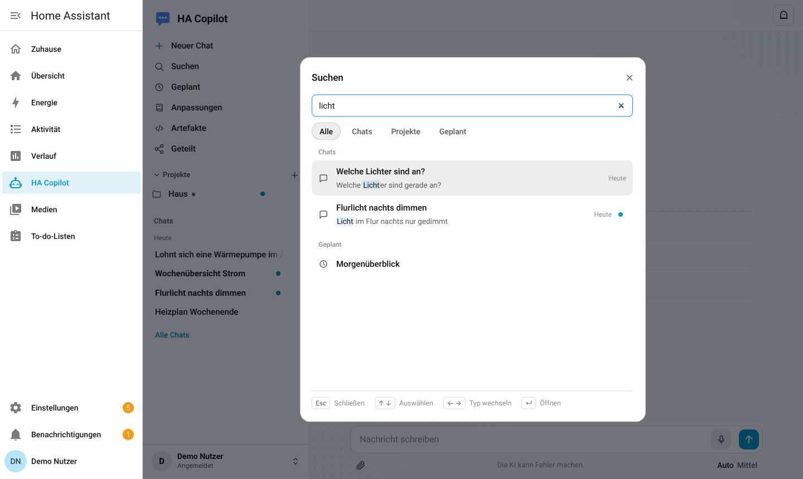

- **Projekte** ordnen Chats und tragen **Anweisungen** (bis 4000 Zeichen), die in jedem Chat des Projekts mitgehen. Zu einem Projekt kannst du **Kontext** hochladen (Notizen, Word, Excel, PDF, ZIP); die KI liest bei Bedarf nach. Die KI hält Wichtiges aus euren Gesprächen **selbstständig** als Notizen im Ordner `KI/` fest (Entscheidungen, Stand, offene Punkte, dazu eine Übersichtsnotiz `stand.md`) und schlägt dort von sich aus nach, so behält ein Projekt alle Chats im Blick. Unter der Antwort erscheint dann eine Karte, die die Notiz öffnet; Notizen lassen sich lesen und bearbeiten. Deine hochgeladenen Dateien ändert sie nie. Hochgeladene Dateien bleiben als **Original** erhalten und lassen sich wieder herunterladen; unter einer erzeugten Datei legt **Im Projekt ablegen** sie im Projekt ab (die KI kann das auch selbst). In einem Projekt kennt die KI außerdem die **anderen Chats dieses Projekts** und liest bei Bedarf in ihnen nach („mach mit dem weiter, was wir letzte Woche besprochen haben“).
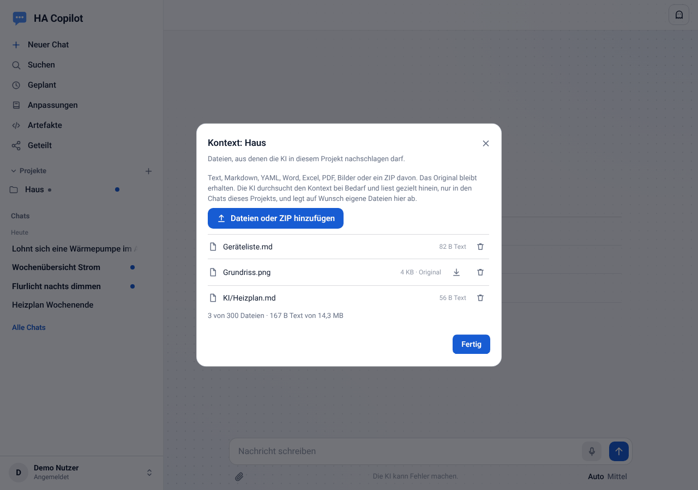

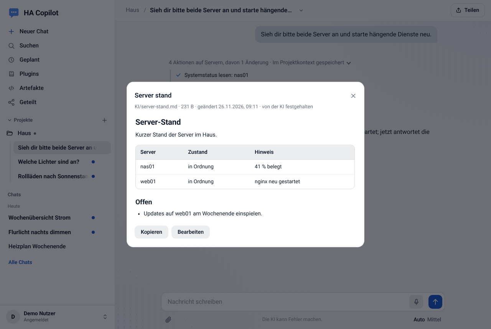

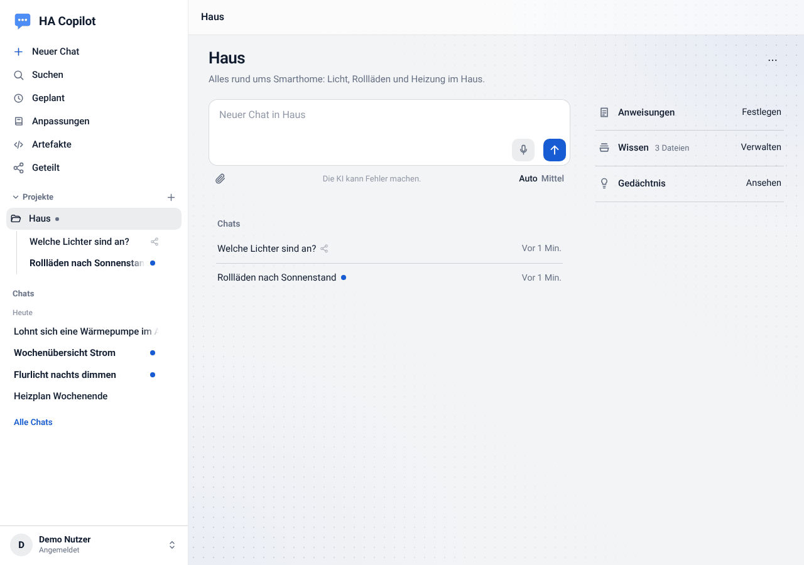

- **Suchen** (Strg/Cmd+Umschalt+F) durchsucht Titel und Nachrichten aller deiner Chats, ohne Rücksicht auf Groß- und Kleinschreibung und Umlaute. Schon vor der ersten Eingabe zeigt das Fenster laufende und zuletzt benutzte Chats; Reiter trennen Chats, Projekte und geplante Aufgaben, Pfeiltasten und Enter genügen zur Bedienung.
- **Tastenkürzel** am Computer: Strg (Mac: ⌘) + Umschalt + **O** neuer Chat, **F** Suchen, **P** neues Projekt, **G** geplante Aufgaben. Das Kürzel steht in der Seitenleiste erst, wenn du mit der Maus über den Eintrag fährst.
- **Rückfragen mit Auswahl (ab 0.67.1):** Ist eine Anfrage offen, fragt die KI wie Claude über dem Eingabefeld zurück: bis zu vier Fragen zum Blättern, Möglichkeiten zum Anklicken (auch mit den Ziffern 1 bis 4) oder Ankreuzen, auf Wunsch mit Vorschau daneben, immer mit **Etwas anderes** und **Überspringen**. Die Box passt ihre Höhe dem Inhalt an. Du kannst auch einfach ins Eingabefeld tippen („Oder direkt antworten …“). Danach stehen Fragen und Antworten als umrandeter Block im Text der Antwort, dort, wo die KI gefragt hat.
- **Hinweise über dem Eingabefeld:** Nutzungslimit und Rückfragen der KI (z. B. vor einer Änderung in Home Assistant) erscheinen als Streifen direkt über dem Eingabefeld, wie in Claude selbst, jeweils als eigene schmale Box (nicht am Eingabefeld angebaut).
- Anpinnen, umbenennen, in ein Projekt verschieben, als Markdown exportieren, archivieren, löschen: alles im Menü (⋯) jeder Zeile.
- **Projektansicht** (ab 0.60.0): Ein Klick auf ein Projekt in der Seitenleiste öffnet eine eigene Seite, wie bei Claude: oben das normale Eingabefeld „Neuer Chat in …“ (mit Anhängen, Sprache und Modellwahl), darunter die Chats des Projekts, unter dem Namen eine kurze **Beschreibung** (anklicken zum Ändern), rechts **Anweisungen**, **Kontext** und **Gedächtnis**. Anhängen, Modell und Senden liegen im Eingabefeld selbst. Beim Erstellen eines Projekts kannst du Beschreibung und, wenn du möchtest, gleich Dateien als **Kontext** mitgeben. Ein weiterer Klick auf das Projekt klappt es in der Seitenleiste zu und wieder auf.
- **Alle Chats** (Eintrag unter der Chatliste, öffnet eine eigene Seite): die ganze Liste über die ganze Breite, kompakt mit Titel links und Datum rechts, mit Reitern Aktiv, Geteilt und Archiviert, Suche und Mehrfachauswahl; das Menü (⋯) erscheint beim Darüberfahren. Archivierte Chats verschwinden aus der Seitenleiste und stehen unter „Alle Chats“ und in der Projektansicht; neues Schreiben holt sie zurück.

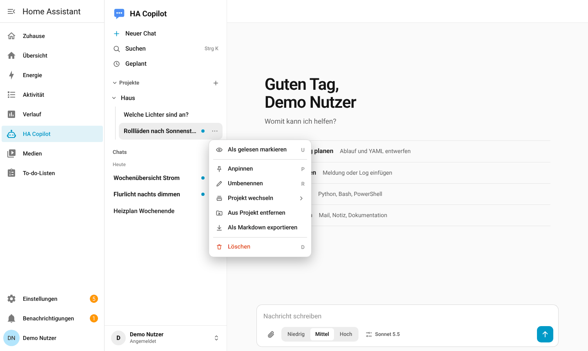

- Unter **Einstellungen → Meine Daten** exportierst du alle Chats als ZIP oder löschst sie unwiderruflich.

Mehr: [Suche, Export und eigene Daten](../copilot/DOCS.md#suche-export-und-eigene-daten-ab-0220).

## Artefakte

- **Dateien der KI öffnen im Fenster (ab 0.63.1):** Ein Klick auf die Dateikarte (Skript, Markdown, CSV, Word, PDF …) öffnet die Datei neben dem Chat mit **Vorschau** oder **Code**, **Bearbeiten** (Textdateien, Speichern legt eine neue Fassung an), **Kopieren** und **Herunterladen**. Word, PowerPoint und PDF erscheinen **als Seiten**, Excel **als Tabelle** (ab 0.65.0, mit Farben und Zahlenformaten); der Pfeil auf der Karte lädt direkt herunter. Gibt es mehrere Fassungen einer Datei, lassen sie sich **durchblättern** und eine ältere lässt sich **wiederherstellen**.
- Größere eigenständige Ergebnisse (HTML-Seite, Zeichnung, **Diagramm**, Dokument, Code-Datei) legt die KI als **Artefakt** an: unter der Antwort steht eine Karte, daneben öffnet sich ein Fenster mit **Vorschau** und **Code**, mit Versionen, Kopieren und Herunterladen. Änderungen („Mach den Titel größer“) erzeugen eine neue Version, die alte bleibt auswählbar. Seiten laufen abgeschottet und ohne Netzwerk; Diagramme (Mermaid, ab 0.60.4) zeichnet der Browser mit einer mitgelieferten Bibliothek, ebenfalls ohne Netzwerk, und sie lassen sich als **PNG oder SVG speichern** (ab 0.65.0). Den Text kannst du selbst ändern (neue Version), eine frühere Version wiederherstellen, das Artefakt im Projekt ablegen oder eine markierte Stelle als Zitat für die nächste Frage nehmen. Mit dem Teilen-Symbol im Fenster gibst du den **Code** (nur lesen, nie als Seite ausgeführt) per Link weiter; **Geteilt** zeigt Artefakte getrennt von Chats. Der Eintrag **Artefakte** in der Seitenleiste ist die Bibliothek: alle Artefakte an einem Ort, mit Suche (Titel, Chat, Inhalt) und Filtern nach Art und Projekt.

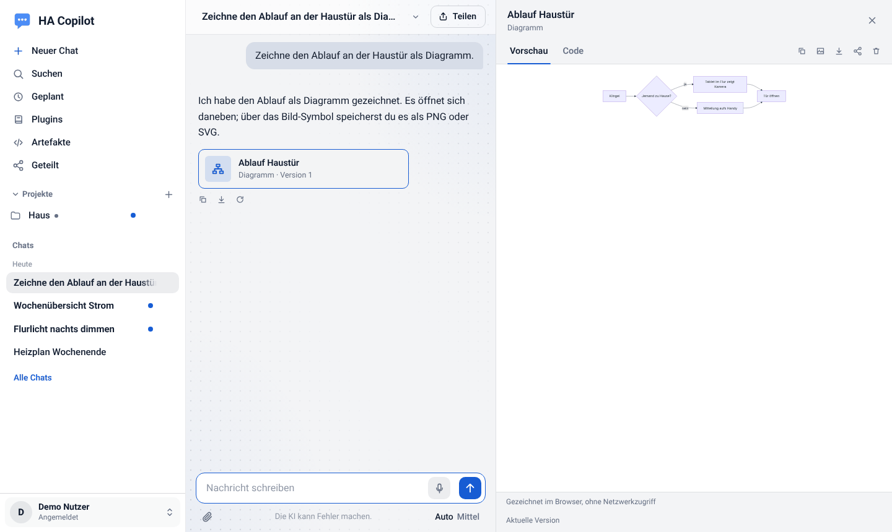

## Mehrere Fassungen einer Antwort

- Mit „Antwort neu erzeugen“ geht die bisherige Antwort nicht verloren: unter der letzten Antwort blätterst du mit `‹ 2/3 ›` zwischen den Fassungen (bis zu 10). Mit einer neuen Frage bleibt nur die gezeigte Fassung. Jede Fassung zählt wie ein eigener Aufruf.

## Verbrauch im Blick

- Administratoren sehen unter **Einstellungen → Nutzung → Alle Personen**, wer wie viel der KI genutzt hat: Anteil an den Token, Bilder und Geld in Euro (bei englischer Sprache Dollar; Claude im Abo ist durch die Pauschale gedeckt und zählt nicht mit), außerdem ob gerade jemand arbeitet oder wann zuletzt etwas geschah, für 24 Stunden, heute, diese Woche, diesen Monat oder den letzten Monat. Es werden nur Zahlen gezählt, nie Inhalte. Administrator ist, wer in Home Assistant Administrator ist, oder wer im Benutzer-Eintrag `admin: true` hat.

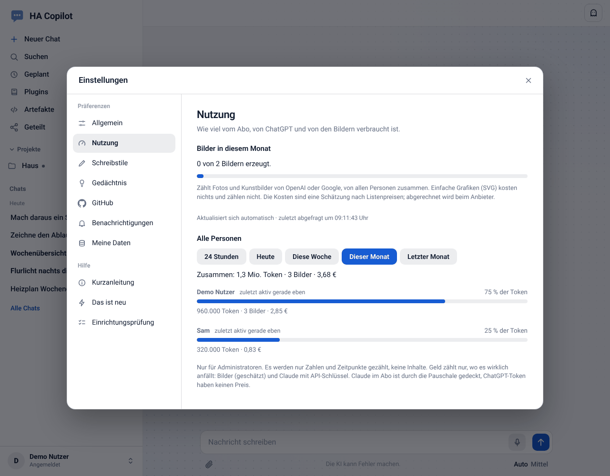

## Schreibstile

- Im Menü unter dem Eingabefeld wählst du den **Stil** der Antworten: Kurz und klar, Ausführlich erklärend, Locker, Formell oder Technisch, oder „Ohne Stil“. Die Wahl gilt für den Chat.
- Unter **Einstellungen → Schreibstile** legst du einen **Standardstil** fest und eigene Stile an, auf Wunsch **aus eigenen Beispieltexten gelernt** (die Texte werden nicht gespeichert). Ein Stil ändert nur Ton, Länge und Gliederung, nie die Regeln und Rückfragen.

## Zugriff auf Home Assistant

Die KI kann Home Assistant benutzen: Zustände ansehen, Verlauf und Logbuch lesen, Geräte schalten und, mit der höchsten Stufe, Automationen, Skripte, Szenen, Dashboards und Helfer bauen. Beispiele:

- „Welche Lichter sind gerade an?“
- „Schalte das Wohnzimmer aus.“
- „Lege eine Szene für den Abend an.“
- „Warum ging die Automation ‚Flurlicht‘ gestern nicht an?“

Was erlaubt ist, hängt von der **Stufe je Benutzer** ab (`none`, `read`, `execute`, `write`, siehe [Benutzer und Rechte](benutzer.md#rechte-der-ki)). Änderungen fragen im Chat nach, Schlösser, Alarmanlagen und Garagentore **immer**. Neustart, Updates, Sicherungen und Benutzerverwaltung sind **nie** möglich. Unter jeder Antwort steht einklappbar, was die KI in Home Assistant getan hat. Vor jeder Änderung an Automationen, Skripten, Szenen und Dashboards sichert das Add-on die alte Fassung (die letzten 60).

Standardmäßig sieht und bedient die KI nur Entitäten, die du in Home Assistant für Assist freigegeben hast (`chat.ha_limit_to_exposed`).

Mehr: [Zugriff auf Home Assistant](../copilot/DOCS.md#zugriff-auf-home-assistant-ab-0150), [Smarthome-Überblick](../copilot/DOCS.md#smarthome-überblick-ab-0170).

## Gedächtnis

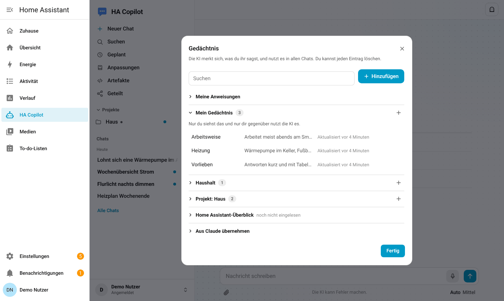

Die KI merkt sich dauerhafte Dinge in kurzen Einträgen und entscheidet selbst, wann das sinnvoll ist (Vorlieben, Entscheidungen, laufende Vorhaben; nicht einmalige Aufträge wie „schreib das kürzer“). Was sie gemerkt hat, steht unter der Antwort. Getrennt wird in **Haushalt** (nur Smarthome-Wissen für alle), **Person** (alles andere, nur du) und, in einem Projekt, **Projekt** (nur in Chats dieses Projekts). Jeder Eintrag zeigt seine **Herkunft** (gesagt, von der KI abgeleitet, von dir eingetragen), und unter der Antwort lässt sich eine Änderung mit **Rückgängig** zurücknehmen. Du siehst, ergänzt und löschst Einträge in den **Einstellungen** unter **Gedächtnis**. Alle Personen dürfen den Haushalt ergänzen. Mit `chat.memory_enabled: false` ist die Funktion aus.

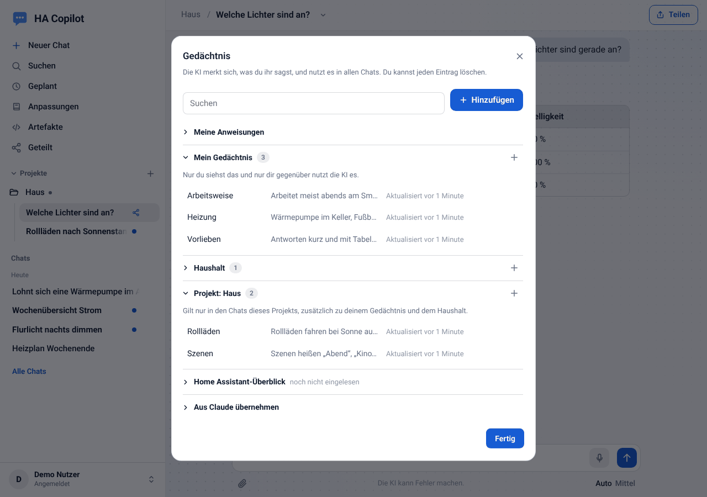

Die Ansicht ist wie bei Claude aufgebaut (ab 0.59.5): Oben **Suche** und **Hinzufügen**, darunter **einklappbare Gruppen** (Meine Anweisungen, Mein Gedächtnis, Haushalt, Projekte, Smarthome-Überblick, Aus Claude übernehmen) mit der Anzahl der Einträge. Jede Zeile zeigt Thema, Vorschau und Datum; ein Klick zeigt den ganzen Text, beim Darüberfahren erscheinen **Bearbeiten** und **Löschen**. So findest du auch bei vielen Einträgen schnell etwas und musst zum Hinzufügen nicht ans Ende scrollen. Ein Eintrag fasst bis zu 2000 Zeichen; Einträge, die früher in Stücke („Thema (2)“) geteilt wurden, erscheinen als eine Zeile.

Im selben Fenster stehen **Meine Anweisungen** (ein Text, der in all deinen Chats mitgeht, etwa „Antworte kurz und duze mich“) und **Aus Claude übernehmen**: Du exportierst dein Gedächtnis bei Claude als ZIP mit Markdown, wählst die Datei hier aus, siehst jeden Fund mit Haken und übernimmst nur, was du willst. Die Vorlieben aus Claude werden zu deinen Anweisungen.

Zusätzlich liest das Add-on selbst einen **Smarthome-Überblick** (Bereiche, Entitäten je Typ, Integrationen, Namen von Automationen) ein und legt ihn als schreibgeschützte Einträge ab. Das kostet keine KI-Nachricht. Es läuft beim ersten Start und danach wöchentlich; mit `chat.memory_enabled: false` ist es aus.

Mehr: [Projektkontext und Gedächtnis](../copilot/DOCS.md#projektkontext-und-gedächtnis-ab-0160).

## Skills

Ein **Skill** ist eine Anleitung für die KI zu einer bestimmten Art von Aufgabe, etwa „Zabbix-Templates erstellen“ oder „Angebote schreiben“. Du findest sie auf der Seite **Plugins** in der Seitenleiste (Filter „Skills“; „Konnektoren“ und „Plugins“ siehe unten). Sie gelten für dich in allen Chats. Du fügst Skills hinzu, indem du sie importierst (`SKILL.md`, `.skill` oder ZIP, mit Vorschau), per **GitHub-Link** aus einem öffentlichen Repository holst, selbst schreibst oder unter **Entdecken** mit einem Klick übernimmst (70 geprüfte Skills in acht Kategorien, mit Suche, zum Beispiel für Marketing, Social Media, Gestaltung und Büro). Auch deine eigenen Skills lassen sich durchsuchen; jede Karte hat ein kleines Symbol. Die KI sieht nur Name und Beschreibung und lädt ein Skill von selbst, wenn die Aufgabe passt (mit `/name` am Anfang einer Nachricht verlangst du ein bestimmtes Skill); nach einer gelösten Aufgabe kannst du sie bitten, **daraus ein Skill zu machen**: Du siehst eine Vorschau und musst bestätigen, ohne Zustimmung speichert sie nichts; auch geplante Aufgaben nutzen sie (nur lesend).

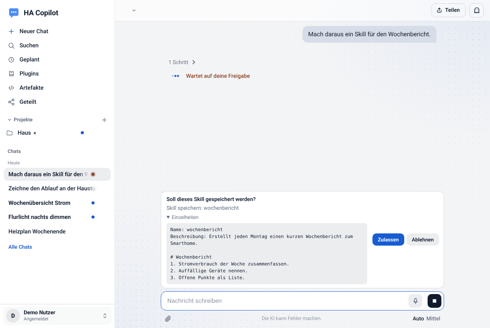

Die mitgelieferten Gestaltungsregeln für Word, PowerPoint, Excel, PDF und HTML stehen als **Standard-Skills** unter „Meine“; sie lassen sich nicht abschalten, aber eigene Skills gehen ihnen vor. Skripte in einem Skill werden **nie ausgeführt**, und importierte Skills gelten als fremder Inhalt: Danach fragt die KI vor Änderungen in Home Assistant oder bei GitHub nach.

Mehr: [Skills](../copilot/DOCS.md#skills-ab-0360).

## Konnektoren

Ein **Konnektor** verbindet die KI mit einem Dienst außerhalb von Home Assistant über das Model Context Protocol (MCP), zum Beispiel mit deinem Zabbix-Server. Du findest sie auf der Seite **Plugins** (Filter „Konnektoren“). Die Seite hat einen gemeinsamen Aufbau für Skills und Konnektoren: **Meine** (deine eigenen Konnektoren stehen oben), **Entdecken** (ein Katalog mit 31 Diensten, zum Beispiel Gmail, Google Kalender, Notion oder Sentry, mit Logos und Suche) und **Community** (Suche im offenen MCP-Register, nicht geprüft). Dort verbindest du Konnektoren mit einem Klick (Token eintragen oder beim Dienst anmelden) und stellst für jedes Werkzeug die Berechtigung ein. Google braucht eine eigene App in der Google Cloud Console, Microsoft 365 gibt es nur als Anleitung für einen selbst betriebenen Server. Eigene Konnektoren bekommen auf Wunsch ein **Logo** (Link oder Upload, PNG/JPEG/GIF/WebP bis 128 kB). Wer die Stufe `own` hat, legt eigene (private) Konnektoren an, wer `global` hat, auch Konnektoren für alle (`connector_access` je Benutzer, vorgegeben `use`).

In der Detailansicht eines Konnektors stehen die Werkzeuge im Reiter **Berechtigungen**, in zwei einklappbaren Gruppen („Lesen“ und „Ändern“); ein Klick auf ein Werkzeug zeigt seine Beschreibung und die Eingaben. Jedes Werkzeug hat eine von drei Stufen: **Immer erlauben** (ohne Rückfrage, auch nach Fremdinhalt), **Genehmigung erforderlich** (die KI fragt im Chat nach; dort gibt es immer auch „In diesem Chat immer zulassen“) oder **Blockiert** (das Werkzeug wird der KI nicht angeboten). Rechts neben dem Gruppentitel setzt eine Auswahl die Stufe für die ganze Gruppe. Vorgabe: lesende Werkzeuge „Immer erlauben“, alle anderen „Blockiert“. Was ein Konnektor liefert, gilt als fremder Inhalt (wie Webseiten): danach fragt die KI vor Änderungen in Home Assistant oder bei GitHub nach. Zugangsdaten liegen verschlüsselt im Add-on; Adressen im Heimnetz (auch mit `http`) dürfen alle eintragen, die Konnektoren anlegen dürfen. Geplante Aufgaben nutzen nur lesende Werkzeuge mit „Immer erlauben“.

Mehr: [Konnektoren](../copilot/DOCS.md#konnektoren-ab-0410).

## Plugins

Ein **Plugin** ist ein Paket aus Skills und Konnektoren zu einem Thema, zum Beispiel „Entwicklung“ oder „Büro & Dokumente“. Du findest sie auf der Seite **Plugins** unter dem Filter „Alle“: **Meine**, **Entdecken** (10 Pakete) und im Menü „Hinzufügen“ **Plugin von GitHub-Link**. Ein Klick auf **Hinzufügen** legt die Skills an und die Konnektoren als „nicht verbunden“ (verbunden wird bei den Konnektoren); wo eine eigene App nötig ist (Google), steht ein Hinweis. Wer ein Claude-Plugin auf GitHub gefunden hat, gibt den Link an: Du siehst in einer Vorschau, was übernommen wird, und kreuzt an, was du willst. Übernommen werden nur Skills und Server-Adressen, nie Befehle, Unteragenten oder Skripte; importierte Skills gelten als fremder Inhalt. Beim **Entfernen** verschwindet nur, was das Plugin selbst angelegt hat.

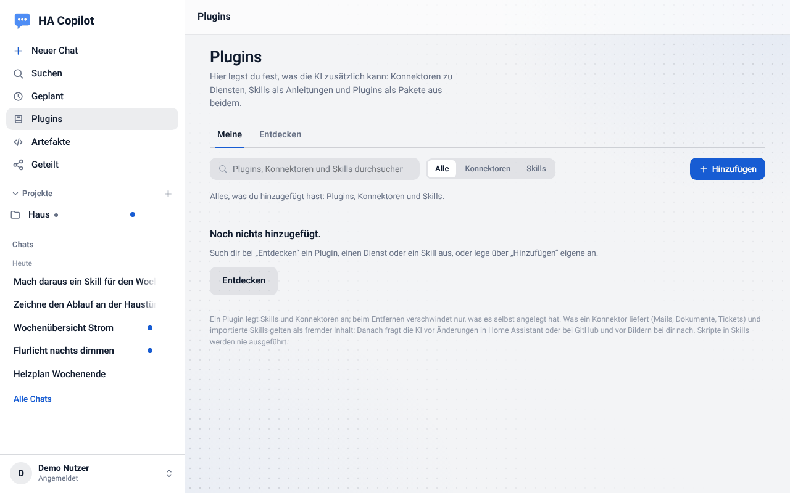

Mehr: [Plugins](../copilot/DOCS.md#plugins-ab-0430).

## GitHub

Sobald du dein GitHub-Konto verbunden hast, arbeitet die KI mit deinen Repositories: lesen, Code durchsuchen, Issues und Pull Requests ansehen, und mit Schreibrecht Dateien einchecken, Zweige und Pull Requests anlegen. Jede Änderung wird im Chat bestätigt; Commits auf den Hauptzweig, Workflow-Dateien und das Mergen immer. Wer nichts verbindet, hat kein GitHub: ein gemeinsames Token des Administrators gibt es nicht mehr.

Einrichtung für dich:

1. Unten links im Konto-Menü **Einstellungen** öffnen und dort **GitHub** wählen (der Eintrag erscheint, wenn der Administrator dir `read` oder `write` gegeben hat).
2. **Mit GitHub verbinden** wählen, den angezeigten Code bei GitHub eingeben und bestätigen. Alternativ **Token einfügen**.
3. Fertig: Der Dialog zeigt „Verbunden als …“. **Trennen** löscht das Token wieder. Ist der Zugang bei GitHub widerrufen oder abgelaufen (ab 0.59.2), steht dort ein Hinweis und der Knopf **Neu verbinden**. Läuft das Token bei GitHub nach einigen Stunden ab, erneuert sich der Zugang von selbst (ab 0.59.4); neu verbinden musst du erst, wenn GitHub auch das ablehnt.

Für den Administrator: Seit 0.57.3 braucht GitHub keine Freigabe mehr; die Optionen `github_access` und `chat.github_access_default` entfallen (alte Einträge werden ignoriert). Die Tokens der Personen liegen verschlüsselt im Add-on. Ein gemeinsames Token (`github_token`) und die Freigabeliste `github_repos` gibt es seit 0.47.0 nicht mehr; alte Einträge in der Konfiguration kannst du löschen.

Mehr: [GitHub](../copilot/DOCS.md#github-ab-0190).

## Sprechen mit der KI

Mit dem Mikrofon-Knopf neben **Senden** sprichst du mit der KI („Aria, mach das Licht im Wohnzimmer aus“; der Name ist `look.app_name`).

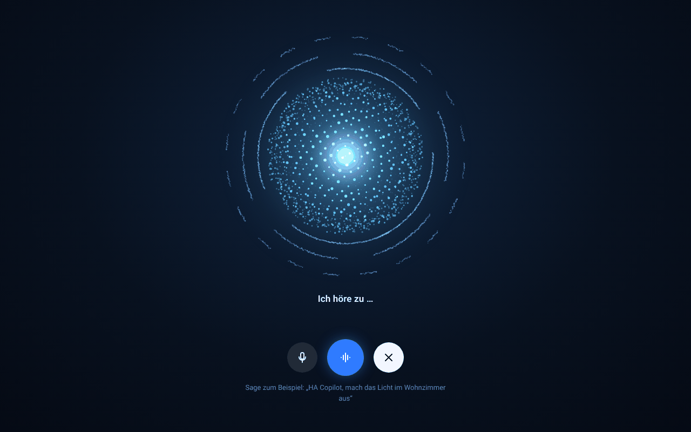

Ein Fenster mit leuchtender Partikel-Kugel (zum Wegwischen mit Maus oder Finger) zeigt, ob sie zuhört, nachdenkt oder antwortet; Stumm, Sprechen und Beenden liegen darunter. Befehle, die Home Assistant selbst versteht, laufen ohne KI und deshalb sofort. Schlösser, Alarmanlagen, Sirenen, Tore, Garagen und die Haustür bedient die KI per Sprache nie, das geht nur getippt. Aus ist der Standard: `voice.access_default` (Gruppe „Sprechen mit der KI“ in der Add-on-Konfiguration) oder je Person `voice_access`. Ein Gespräch aus der Startseite steht nicht in der Chatliste (löscht sich nach `voice.chat_days` Tagen), ein Gespräch mitten in einem Chat gehört zu diesem Chat. Das Mikrofon braucht `https`. Mit einem OpenAI-Schlüssel (`voice.openai_api_key` oder der gemeinsame `images.openai_api_key`) erkennt und spricht OpenAI statt Whisper und Piper (die Stimme wählst du bei `voice.openai_voice`, Standard weiblich); die Einrichtung steht in [API-Konto für Bilder und Sprache](bilder-konten.md#openai-für-die-sprache-spracherkennung-und-stimme). Fehlen Whisper oder Piper oder laufen sie nicht, weicht das Sprechen auf den Browser bzw. die Gerätestimme aus und die Einrichtungsprüfung sagt, was zu tun ist. Auf dem Handy schaltet schon das Antippen die Sprachausgabe frei; klappt das Vorlesen trotzdem nicht, steht die Antwort als Text im Fenster. Die Stimme fängt schon beim ersten fertigen Satz an; die Antworten sind kurz und ohne Gerätenamen, eigene Wünsche dazu stehen in `voice.instructions`; wie lange Erkennung, KI und Stimme brauchen, steht je Runde im Protokoll. Mehr in der [Dokumentation](../copilot/DOCS.md#sprechen-mit-der-ki-ab-0520).

## Linux-Server

Deine Debian-, Ubuntu-, Red-Hat- und Fedora-Server melden sich mit einem kleinen **Agenten** bei einem Hub im Add-on. Die Seite **Server** in der Seitenleiste zeigt sie auf einen Blick: online, eingeschränkt (ein fast voller Datenträger), offline, ausstehend oder gesperrt, jeweils mit einem Statuspunkt vor dem Namen. Jeder Server ist ein aufklappbarer Eintrag; fehlgeschlagene Dienste zeigt eine orange Markierung, ohne den Status zu ändern. Ein neuer Server erscheint als **Ausstehend** und wird erst nach deiner Bestätigung für die KI nutzbar; hast du die App gerade nicht offen, kommt eine Meldung aufs Handy. Unter **Server hinzufügen** bekommst du ein fertiges Skript mit allen Angaben (Adresse, Schlüssel, Prüfsummen), das du kopieren oder herunterladen und auf dem Server als root ausführst; solange der Schlüssel gilt, kannst du es unter **Gültige Schlüssel** wieder anzeigen, und die Seite zeigt von selbst, wann sich der Server gemeldet hat.

Die KI darf die Server **ansehen** (Zustand, Speicher, Datenträger, Dienste, Protokolle, Updates, Netzwerk, Anmeldungen) und hilft so bei der Fehlersuche. Seit 0.60.7 kann sie auch **Änderungen vorschlagen**: einen Dienst neu starten, Pakete installieren oder aktualisieren (mit apt oder dnf), einen Befehl ausführen. Im Chat siehst du dann den genauen Befehl mit einer Risikostufe (1 umkehrbar, 2 weitreichend) und entscheidest mit **Zulassen**, **Ablehnen** oder **Für <Server> im Chat immer** (gilt nur für diesen einen Server in diesem Chat; ein anderer Server fragt erneut). Gefährliches (SSH oder Netzwerk stoppen, Datenträger löschen, Neustart) wird nie ausgeführt. Ob ein Server Änderungen überhaupt erlaubt, entscheidet nur die Datei `/etc/copilot-agent/policy` auf dem Server. Jeder Aufruf steht im Reiter **Aktivität**. Wer Zugriff hat, regelst du ganz oder gar nicht: Administratoren haben ihn von selbst, für alle anderen gilt `servers.access_default` oder je Person `server_access` (`off` schließt auch einen Administrator aus). Aus ist der Standard, ebenso der ganze Hub (`servers.enabled`). Die Verbindung baut der Agent selbst auf (TLS mit gegenseitiger Prüfung), auf den Servern lauscht nichts; der Hub braucht Port 8101 im Heimnetz oder VPN. Seit 0.61.0 kann die KI zusätzlich den **Verlauf** eines Servers ansehen, **Dateien lesen** (Schlüssel und Kennwörter bleiben verborgen), Paketinformationen und Container nachsehen und, nur nach deiner Freigabe mit Vergleich und Sicherungskopie, **Textdateien ändern**. Der **Agent auf dem Server aktualisiert sich selbst** (auf Knopfdruck oder automatisch, ohne neues Skript; bei einem Fehlstart stellt er die alte Fassung wieder her), und sein **Zertifikat erneuert sich** lange vor dem Ablauf von allein. Das Plugin **Linux-Betrieb** (Anpassungen → Plugins) bringt Anleitungen für typische Störungen mit, und **Untersuchen** startet einen Chat mit einer Vorlage. Auf dem Server ist alles Englisch, die Seite „Server“ folgt der Sprache der App. Mehr in der [Dokumentation](../copilot/DOCS.md#linux-server-ab-0604).

**Automatische Updates (ab 0.68.0):** Pro Server kannst du Systempakete und Sicherheitspatches zu einer festen Zeit oder auf Knopfdruck einspielen lassen (Karte des Servers → **Automatische Updates**). Das Fenster zeigt, was beim nächsten Lauf installiert würde, und jedes Paket hat ein Kästchen zum Herausnehmen. Was Ärger machen kann (Kernel, Netzwerk, Datenbanken, Container, Server-Anwendungen, große Versionssprünge, Pakete aus Drittquellen), ist von vornherein herausgenommen, mit Begründung, und lässt sich mit dem Häkchen dazunehmen (nur diesmal oder dauerhaft). Eingeschaltet wird nur dort; die KI im Chat kann es nicht. Der Server muss Änderungen lokal erlauben, und mit `auto_update=deny` in `/etc/copilot-agent/policy` sperrt er die Funktion für immer. Es gibt nie einen automatischen Neustart. Alle Einzelheiten in der [Dokumentation](../copilot/DOCS.md#linux-server-ab-0604).

**Updatepläne (ab 0.69.0):** Statt jeden Server einzeln zu planen, legst du im Reiter **Automatische Updates** der Seite „Server“ einen Plan mit Zeitfenster an, zum Beispiel jede Nacht zwischen 2 und 3 Uhr, und weist ihm mehrere Server zu. Die Server kommen nacheinander dran, gleichmäßig über das Fenster verteilt, nie zwei gleichzeitig. Im Fenster „Automatische Updates“ eines Servers siehst du, ob er einem Plan folgt, springst mit **Plan ansehen** zu den Einzelheiten und kannst ihn pausieren, aus dem Plan nehmen oder seinen eigenen Zeitplan nutzen; der bleibt beim Mitmachen gespeichert. Paketausnahmen bleiben je Server. Eingestellt wird nur dort, die KI im Chat kann es nicht. Alle Einzelheiten in der [Dokumentation](../copilot/DOCS.md#linux-server-ab-0604).

In **geplanten Aufgaben** darf die KI die Server nur ansehen, zum Beispiel für einen Bericht jeden Morgen über volle Datenträger, fehlgeschlagene Dienste und ausstehende Updates; ändern kann ein solcher Lauf nichts.

Die Agenten aktualisieren sich selbst (Knopf oder automatisch). Auf Wunsch nehmen sie nur Programme an, die mit dem Schlüssel dieses Repositorys signiert sind; die Einrichtung (einmalig, über GitHub) steht in [SECURITY.md](../SECURITY.md#agenten-programme-signieren-einmalige-einrichtung).

## Websuche und Modelle

- Die KI sucht im Web und liest Seiten, wenn es nötig ist oder du darum bittest. Pro Benutzer steuerbar (`web_access`). Seiten aus dem Heimnetz und interne Adressen werden nie geladen.
- **Auto** im Modellmenü wählt seit 0.67.0 je Nachricht das passende Claude-Modell: Haiku für leichte Fragen und Befehle, Sonnet (`chat.model`) für normale Aufgaben, Opus für Analysen, Konzepte, Fehlersuche und viel Code. Ist ChatGPT eingeschaltet, gehen Texte und Alltagsfragen an ein ChatGPT-Modell, Technik, Code und Smarthome bleiben bei Claude; ein kleiner Hinweis über der Antwort zeigt jeden Wechsel des Anbieters. Ein persönliches Standardmodell oder eine Wahl im Chat gehen vor. Opus und Haiku sind im Chat zusätzlich fest wählbar. Jede Person kann unter Einstellungen → Allgemein ein **Standardmodell** für neue Chats festlegen.

| Auto im Menü (Handy) | Hinweis, wenn Auto zu ChatGPT wechselt |
|---|---|
| 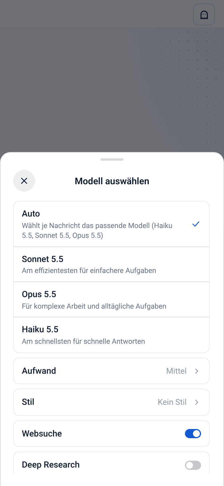 | 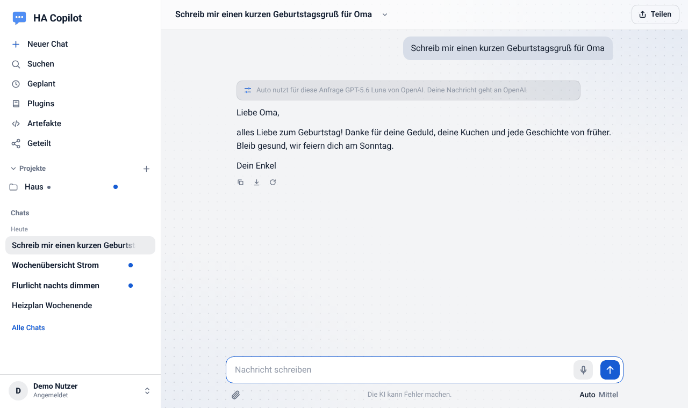 |

- **ChatGPT (OpenAI) neben Claude** (optional, Standard aus): Mit `chat.openai_enabled` und einem OpenAI-Schlüssel stehen ChatGPT-Modelle zur Wahl, mit denselben Fähigkeiten (Home Assistant, Gedächtnis, Dateien, Bilder, GitHub, Konnektoren, Websuche, geplante Aufgaben). Ein ChatGPT-Chat geht an OpenAI, nie an Claude; das Sprechen bleibt bei Claude Haiku. Gemeinsames Monatslimit für alle Personen (Standard 3 Millionen Token), danach fragt der Chat nach. Einrichtung und Grenzen: [ChatGPT (OpenAI) einrichten](chatgpt.md).
- Ist ein Limit deines Abos fast erreicht, erscheint oben im Chat ein Hinweis mit der Zeit der Rücksetzung.

Mehr: [Web, Modell und Nutzungslimit](../copilot/DOCS.md#web-modell-und-nutzungslimit-ab-0200).

## Dateien erzeugen

Auf Wunsch legt die KI **Word, Excel, PowerPoint, PDF** und Skripte (PowerShell, Shell, Python …) an. Unter der Antwort erscheint eine Karte mit Download. Die Dateien bleiben 14 Tage und gehören nur dir. Abschalten mit `chat.files_enabled: false`.

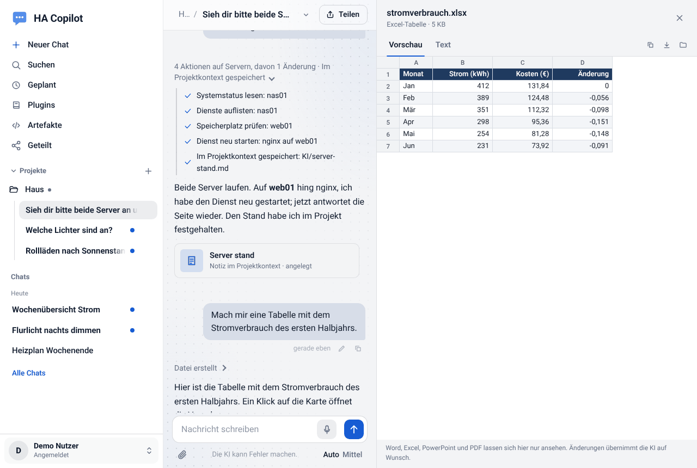

Die KI gestaltet neue Dateien nach Designregeln (Leitfäden, sieben Farbthemen, auf Wunsch deine Markenfarbe), mit großer Schrift, Kartenfolien, Bildfolien, farbigen Titel- und Zwischenfolien, Seitenzahlen und aufgeräumten Tabellen; auch für HTML-Präsentationen gibt es einen Leitfaden. Sie bettet Bilder, SVG-Zeichnungen und Diagramme ein, setzt ein Inhaltsverzeichnis, Links, Deckblätter, Zitat-, Kennzahlen- und Zwei-Spalten-Folien und prüft ihr Ergebnis per Vorschau-Bild. Für Mac, iPad und iPhone erzeugt sie Dateien für Keynote, Pages und Numbers.

Mehr: [Dateien erzeugen](../copilot/DOCS.md#dateien-erzeugen-ab-0180), [Gestaltung der Dateien](../copilot/DOCS.md#gestaltung-der-dateien-ab-0300).

## Bilder

Die KI erkennt selbst, wenn du ein Bild möchtest, und erzeugt es: **einfache Grafiken** (Diagramme, Pläne, Logos, Symbole) zeichnet sie kostenlos als **SVG**, **Fotos und Kunst** lässt sie von **OpenAI oder Google** erzeugen (eigener API-Schlüssel nötig). Sie sagt dir, welchen Weg sie gewählt hat. Das Bild erscheint als Karte unter der Antwort; ein Klick öffnet die **Bildvorschau** (groß, Herunterladen, Schließen). Solange ein Bild entsteht, zeigt eine Platzhalterkarte „Bild wird erzeugt …“.

Gefällt dir etwas nicht, schreibst du es einfach in denselben Chat: Die KI ändert das vorhandene Bild (oder ein angehängtes Foto) und legt eine neue Fassung („Version 2“) daneben. Jede Person darf je Monat `images.limit_month` Bilder von OpenAI/Google erzeugen (Standard 30); erst darüber fragt der Chat vor jedem weiteren Bild nach. SVG kostet nichts und zählt nicht. Nach dem Lesen von Web- oder Dateiinhalten fragt die KI vor jedem Bild von OpenAI/Google immer nach. In geplanten Aufgaben entstehen keine Bilder.

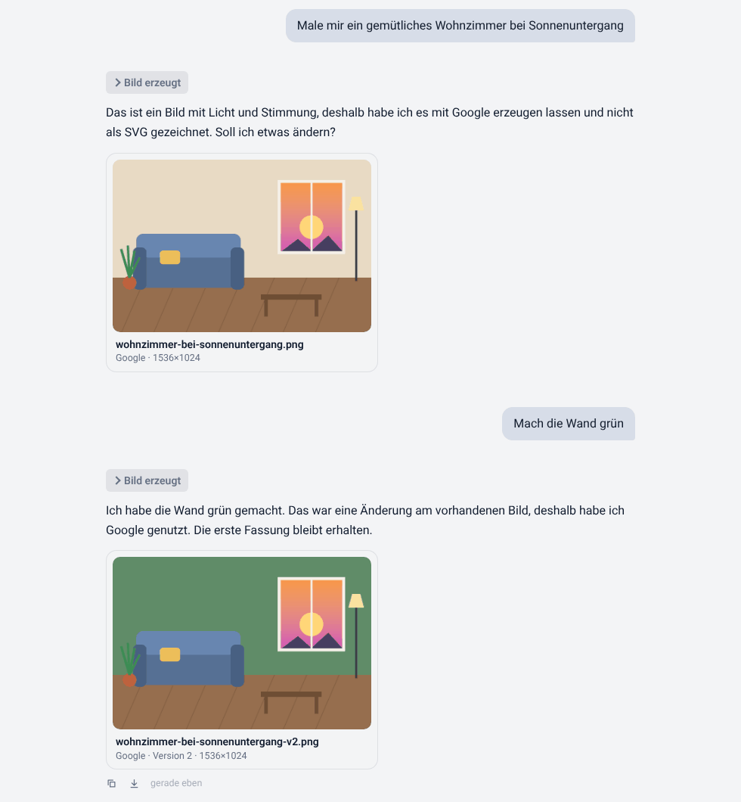

| | |
|---|---|
| 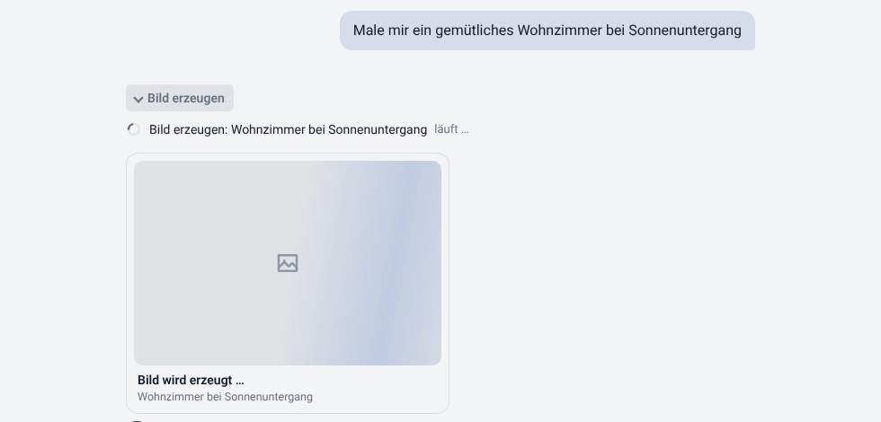 | 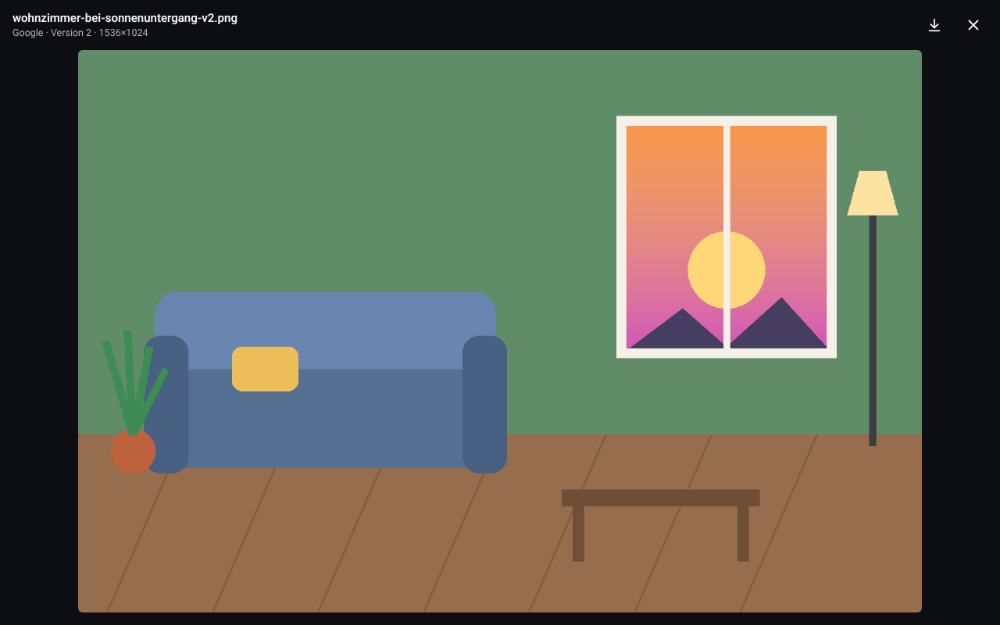 |

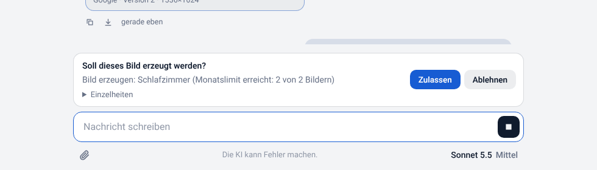

Mehr: [API-Konto und Schlüssel anlegen](bilder-konten.md), [Bilder (Einrichtung, Kosten, Datenschutz)](../copilot/DOCS.md#bilder-ab-0280).

## Geplante Aufgaben und Benachrichtigungen

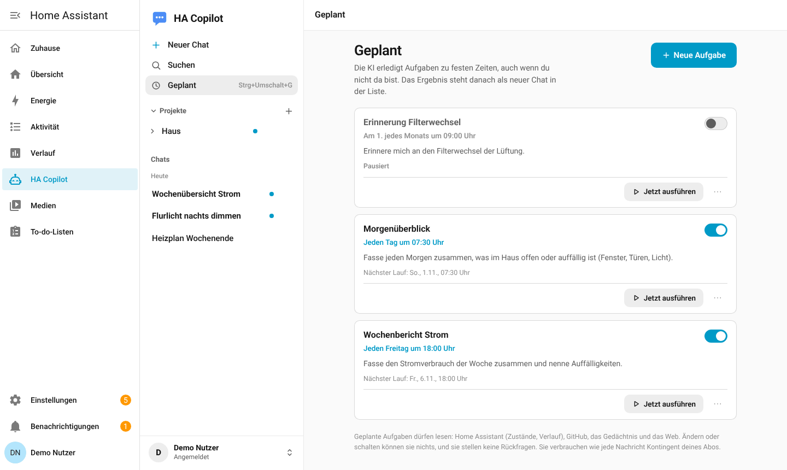

Unter **Geplant** legst du Aufgaben an, die die KI zu festen Zeiten erledigt (täglich, Montag bis Freitag, wöchentlich, monatlich, einmalig), zum Beispiel einen Morgenüberblick über das Haus. Sie dürfen **nur lesen**: Home Assistant, GitHub und Gedächtnis werden nie verändert. Das Ergebnis steht als ungelesener Chat in der Liste und optional als Meldung in Home Assistant oder aufs Handy (`notify_service` beim Benutzer).

Bleibt eine Antwort ungelesen, weil der Chat auf keinem Gerät offen ist, bekommt die Person eine Handy-Benachrichtigung (siehe „Benachrichtigung aufs Handy“ in der DOCS). `chat.schedules_enabled: false` schaltet die Seite ab.

Mehr: [Geplante Aufgaben](../copilot/DOCS.md#geplante-aufgaben-ab-0210).

## Design: Hintergrund-Muster und Themes

Hinter dem Chat liegt ein feines, ruhiges Muster, das nicht von den Texten ablenkt. Unter **Einstellungen → Allgemein → Design** wählt jede Person für sich, welches. Die Wahl gilt auf jedem Gerät der Person.

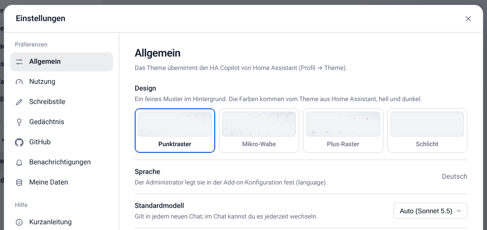

| Muster | Aussehen |
|---|---|
| **Punktraster** (Standard) | Sehr feine Punkte, nur in zwei Ecken sichtbar und zur Mitte hin ausgeblendet |
| **Mikro-Wabe** | Dünne Sechsecke |
| **Plus-Raster** | Kleine Pluszeichen |
| **Schlicht** | Kein Muster, nur die Farbe des Themes |

Punktraster:

Mikro-Wabe:

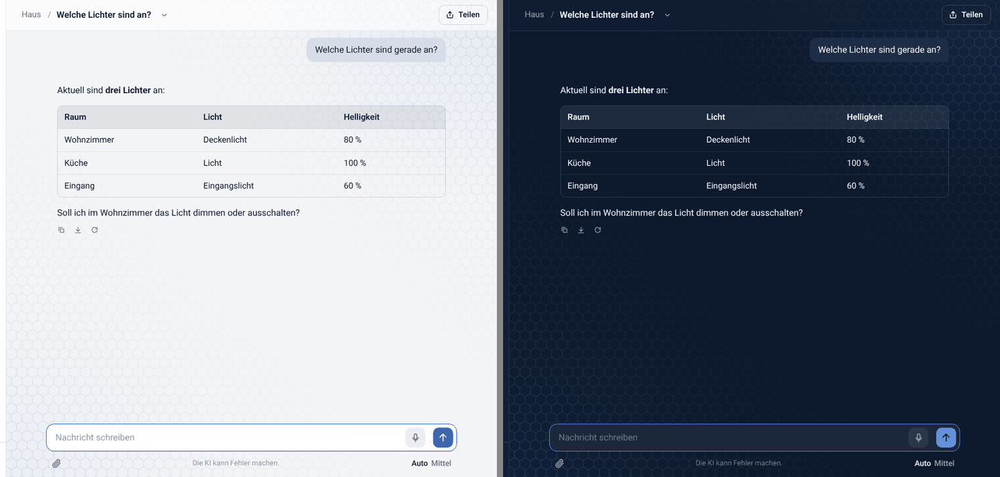

Plus-Raster:

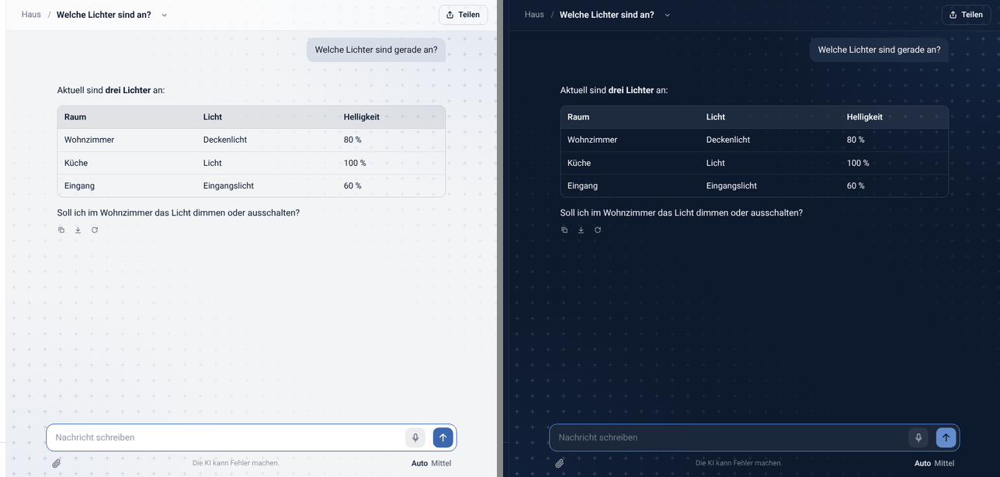

### Die Farben kommen aus Home Assistant

**Das Theme übernimmt der HA Copilot von Home Assistant.** Muster und das leise Leuchten dahinter sind aus dem Akzent, dem Hintergrund und der Schriftfarbe des aktiven Themes gemischt (Profil → Theme, hell oder dunkel). Es gibt keine eigenen Farbwerte: Wer in Home Assistant das Theme wechselt, sieht das Muster sofort in den neuen Farben; auch über die Domain, sobald der Copilot das Theme der Person einmal in HA gesehen hat (Darstellung „Wie Home Assistant“). Das Muster steht still und stört weder Lesen noch Akku.

Als Beispiele liegen vier weitere Themes bereit, die zu den Mustern passen. Die Datei [`themes/doralab-weitere.yaml`](themes/doralab-weitere.yaml) kommt nach `/homeassistant/themes/` (wie jede Theme-Datei in Home Assistant, mit `themes: !include_dir_merge_named themes` in der `configuration.yaml`); danach in den Entwicklerwerkzeugen unter YAML „Themes neu laden“ (`frontend.reload_themes`) und im Profil unter **Theme** auswählen. Oben jeweils hell, unten dunkel: *Nordlicht*, *Dämmerung*, *Bernstein*, *Smaragd*.

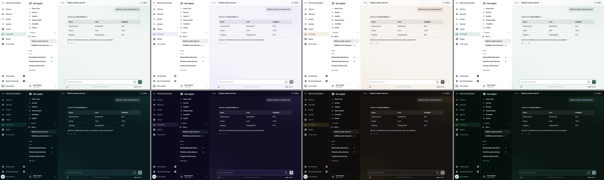

## Aussehen und Sprache

- **Theme:** Im Home-Assistant-Panel übernimmt die App live die Farben und Hell/Dunkel von Home Assistant (`look.follow_ha_theme`). Über die Domain gilt das zuletzt in HA gesehene Theme der Person („Wie Home Assistant“, ab 0.59.5), sonst das Standard-Theme oder ein eigenes (`look.theme_name`).
- **Name, Logo, Texte, Farben:** `look.app_name`, `look.login_text`, `look.login_placeholder`, die Farboptionen (`accent_color` …), eigene Dateien `logo.png`, `icon.png` und `custom.css` im Ordner `addon_config` des Add-ons. Eine eigene Seitenleisten-Beschriftung („HA Copilot“) steht dagegen fest in der Add-on-Konfiguration von Home Assistant.
- **Sprache:** `language: de` (Standard) oder `en`. Gilt für Oberfläche, Meldungen, Einrichtungsprüfung, Export und Benachrichtigungen.

| Home Assistant dunkel | Die App allein, hell | Die App allein, dunkel |
|---|---|---|
| 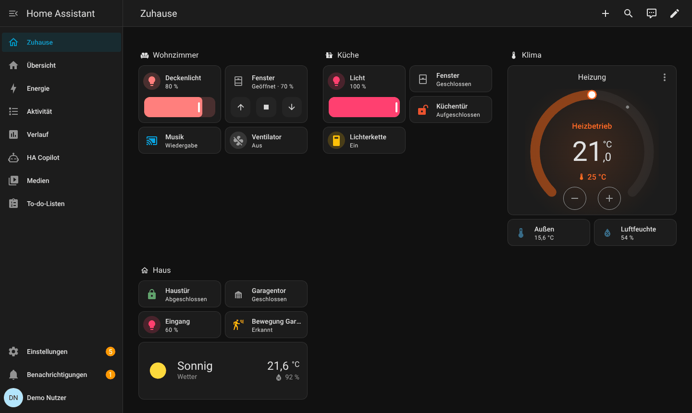 | 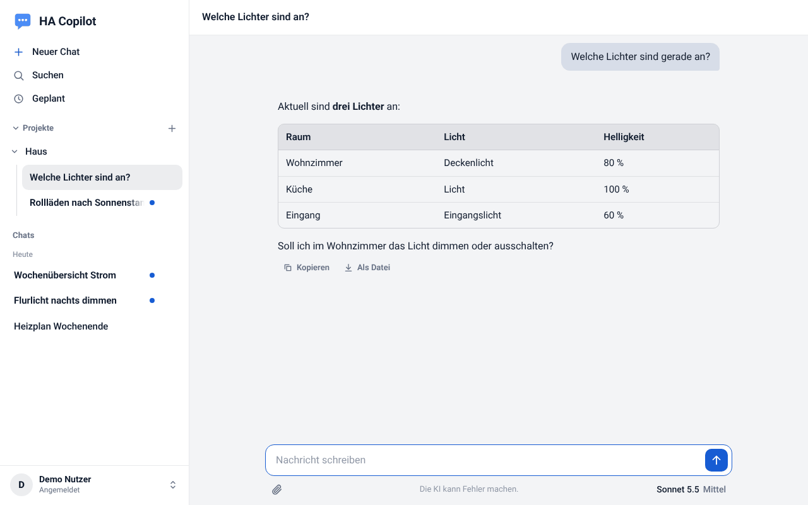 | 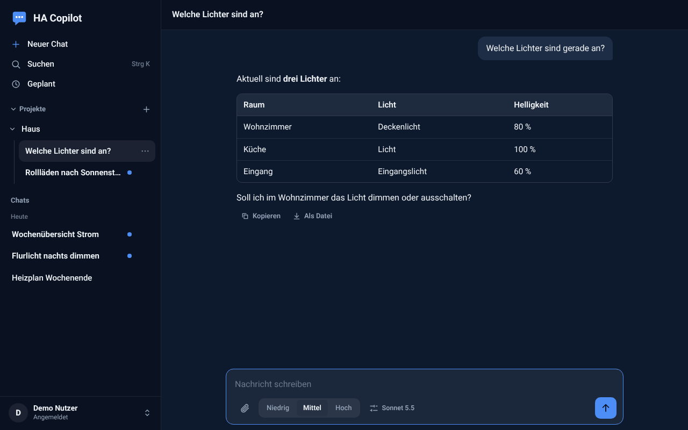 |

Mit einem eigenen Home-Assistant-Theme (hier „DORALAB“, nur Farben) übernimmt die App Akzent, Flächen und Schrift live, hell und dunkel:

| Eigenes Theme, hell | Eigenes Theme, dunkel |
|---|---|
| 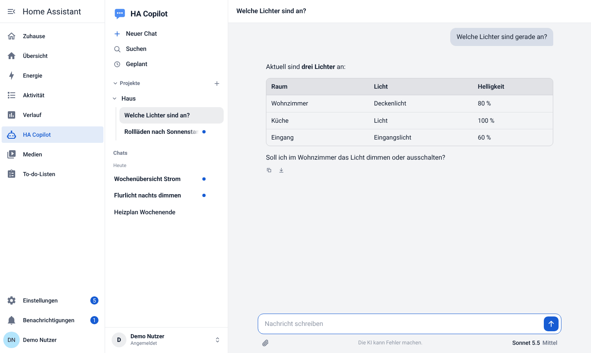 | 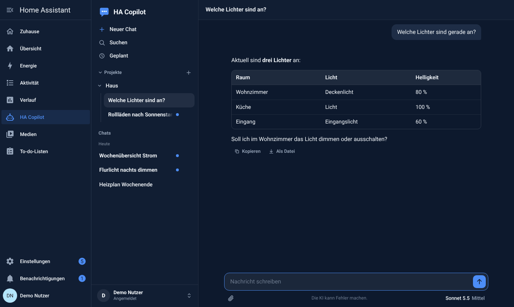 |

Englische Oberfläche (`language: en`):

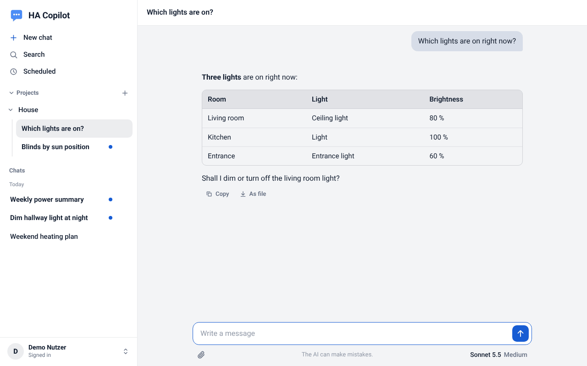

Mehr: [Personalisierung](../copilot/DOCS.md#personalisierung-name-logo-texte-farben), [Sprache](../copilot/DOCS.md#sprache-ab-0260).

## Auf dem Handy

Die Oberfläche passt sich dem Gerät an: Die Chat-Liste öffnet als Fenster von unten, Menüs werden zu Fenstern. Über die Domain (im Browser) öffnet die Seitenleiste auch mit einer Wischgeste von links nach rechts. In Home Assistant gibt es das nicht, dort öffnet diese Geste die Seitenleiste von Home Assistant. Über die Domain lässt sich HA Copilot im Handy-Browser mit „Zum Home-Bildschirm“ als eigene App ablegen. Für iPhone und iPad entsteht eine eigene App (ab 0.59.0 stellt das Add-on dafür die Anmeldung bereit, einzuschalten mit `domain.app_access`); die Geräte siehst du in den Einstellungen unter **Geräte (App)**. Siehe [App-Zugang](app.md).

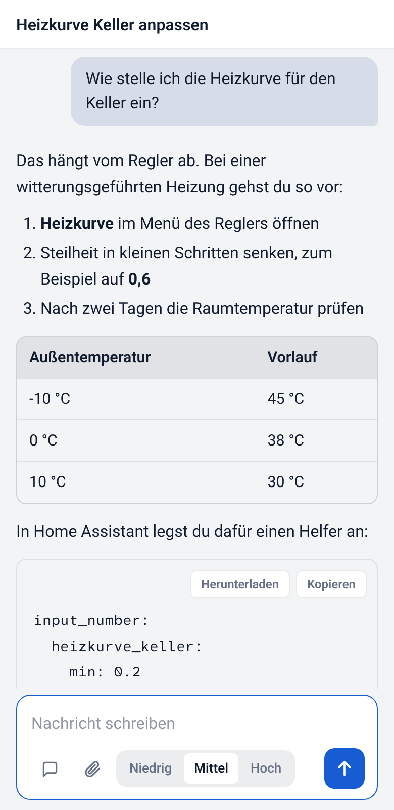

## Einrichtungsprüfung

In den **Einstellungen** zeigt die **Einrichtungsprüfung**, was fehlt, mit den genauen Schritten, und prüft Home Assistant, GitHub, den Benachrichtigungsdienst, die Sprach-Pipeline (welche Spracherkennung und Stimme gelten) und, wenn eingeschaltet, den ChatGPT-Zugang live. Siehe [Installation](installation.md#6-einrichtungsprüfung).

## Sicherheit und Datenschutz

- Chats liegen in einer SQLite-Datenbank im Add-on-Speicher (Teil jeder HA-Sicherung). Texte deiner Nachrichten und Anhänge gehen zur Beantwortung an Anthropic, in einem Chat mit einem ChatGPT-Modell (nur wenn der Administrator ChatGPT eingeschaltet hat) stattdessen an OpenAI, nie an beide; nur wenn du Bilder von OpenAI oder Google erzeugen lässt (eigene Schlüssel nötig), gehen der Bildwunsch und ein Referenzbild an den gewählten Anbieter, sonst an niemanden. Kopien von Anhängen (für das Bearbeiten) liegen für 14 Tage im Datenordner des Add-ons und verschwinden mit dem Chat.
- Jede Abfrage ist auf das Profil gefiltert; Benutzer sehen nie die Chats anderer. Ausnahmen gibt es nur, wenn du einen Chat selbst teilst (siehe oben); öffentliche Links sind standardmäßig aus.
- Rechte setzt der Server durch, nicht die KI. Alles, was von außen kommt (Home Assistant, Web, GitHub, Konnektoren, Dateien), gilt für die KI als Information und nicht als Anweisung; nach dem Lesen fremder Inhalte fragt jede Änderung im Chat nach.
- Die Domain-Anmeldung prüft die Identität serverseitig (OpenID Connect mit PKCE), Sitzungen liegen serverseitig, Cookies sind `Secure` und `HttpOnly`.

Mehr: [Sicherheit in Kürze](../copilot/DOCS.md#sicherheit-in-kürze), [SECURITY.md](../SECURITY.md).
