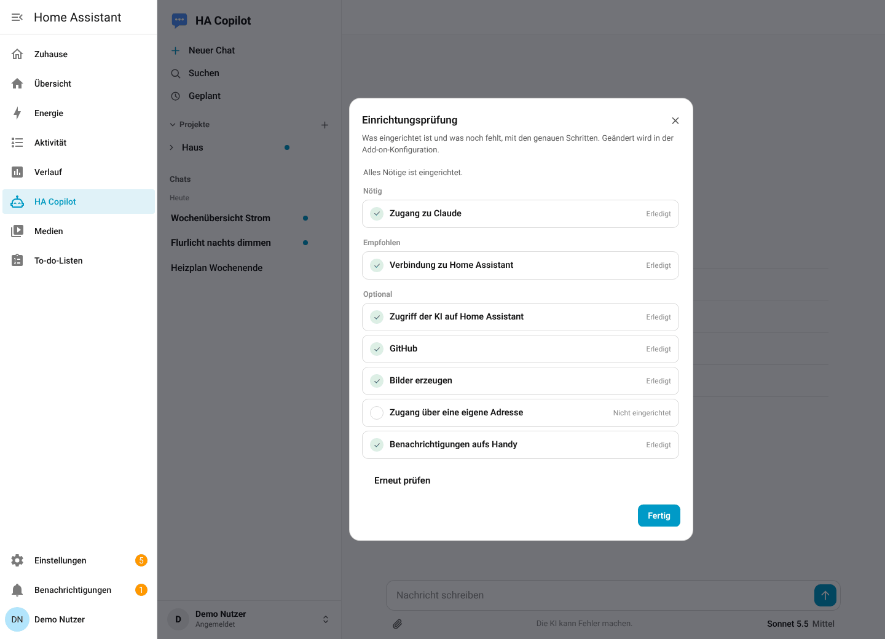

# Installation

Diese Anleitung führt von einer leeren Home-Assistant-Installation bis zum ersten Chat. Sie dauert etwa zehn Minuten. Danach geht es weiter mit [Benutzer und Rechte](benutzer.md) und [Alle Einstellungen](einstellungen.md).


## Voraussetzungen

- **Home Assistant mit Supervisor** (Home Assistant OS oder Supervised). Add-ons (ab Home Assistant 2026.2 heißen sie „Apps“) gibt es nur dort, nicht bei „Container“ oder „Core“.
- Prozessor `amd64` oder `aarch64` (Mini-PC, Raspberry Pi 4/5, virtuelle Maschine).
- **Zugang zu Claude:** ein API-Schlüssel aus der [Claude-Konsole](https://platform.claude.com/) oder, nur für deinen eigenen Gebrauch, ein Token deines Claude-Abos. Was wann der richtige Weg ist, steht unter [Zugang zu Claude](#4-zugang-zu-claude).
- Optional: ein GitHub-Token, eine eigene Domain mit Microsoft Entra ID, ein Benachrichtigungsdienst fürs Handy. Alles davon lässt sich später nachrüsten.

Die Begriffe in Home Assistant wechseln je nach Version („Add-ons“ oder „Apps“, „Add-on-Store“ oder „App-Store“). Diese Anleitung nennt beide, wo es darauf ankommt.

## 1. Repository hinzufügen

1. In Home Assistant **Einstellungen → Add-ons** (bzw. **Apps**) öffnen.
2. Unten rechts **Add-on-Store** (bzw. **App installieren**) wählen.
3. Oben rechts auf **⋮ → Repositories** tippen.
4. Diese Adresse eintragen und mit **Hinzufügen** bestätigen:

   ```
   https://github.com/dominikramachers/HA-Copilot
   ```

5. Das Fenster schließen und die Seite neu laden (F5). Im Store erscheint ein neuer Abschnitt mit **HA Copilot**.

## 2. Installieren

1. **HA Copilot** anklicken, **Installieren** wählen. Der Bau des Images dauert je nach Gerät ein bis fünf Minuten.
2. Noch **nicht** starten. Zuerst die Konfiguration (nächste Schritte).
3. Auf dem Reiter **Info** diese Schalter setzen:
   - **In der Seitenleiste anzeigen:** an. Dann erscheint „HA Copilot“ in der Seitenleiste von Home Assistant.
   - **Beim Hochfahren starten:** an.
   - **Watchdog:** an (startet das Add-on nach einem Absturz neu).

## 3. Benutzer eintragen

Auf dem Reiter **Konfiguration** steht unter **Benutzer (Profile)** schon ein Eintrag „Administrator“, der auf niemanden passt. Ersetze ihn durch deinen eigenen Benutzer:

```yaml
profiles:
  - ha_user: dein-ha-benutzername
    label: Dein Name
```

`ha_user` ist dein Anmeldename in Home Assistant, also der Name, mit dem du dich dort anmeldest. Beim Start schreibt das Add-on alle Benutzer mit Anmeldename und ID ins Protokoll. Alles Weitere, auch weitere Benutzer und ihre Rechte, steht unter [Benutzer und Rechte](benutzer.md).

Weißt du den Namen nicht? Starte das Add-on trotzdem, öffne die App und lies ihn von der Seite „Kein Zugriff“ ab (siehe [Benutzer und Rechte](benutzer.md#schritt-für-schritt-den-ersten-benutzer-anlegen)).

## 4. Zugang zu Claude

Trage **eines** von beidem in der Konfiguration ein:

```yaml
anthropic_api_key: sk-ant-...        # API-Schlüssel, Abrechnung nach Verbrauch
# oder
claude_oauth_token: sk-ant-oat-...   # Token deines Abos, nur für dich allein
```

Setze danach `backend` auf `claude`. Bis dahin läuft das Add-on im **Testmodus** (`backend: echo`): Es gibt deine Nachricht nur zurück, ruft keine KI auf und kostet nichts. So lässt sich die Einrichtung ohne Risiko ausprobieren.

### Welchen Zugang nehme ich?

| | API-Schlüssel | Abo-Token |
|---|---|---|
| Wofür | der von Anthropic vorgesehene Weg für Programme | nur dein eigener, persönlicher Gebrauch |
| Abrechnung | nach Verbrauch (Claude-Konsole) | im Abo enthalten (Pro oder Max) |
| Mehrere Benutzer | ja | **nein** |
| Domain-Zugang | ja | **nein** |
| Erzeugen | in der [Claude-Konsole](https://platform.claude.com/) unter „API keys“ | `claude setup-token` (Claude-Code-Programm auf irgendeinem Rechner, mit dem Abo angemeldet) |

> **Wichtig zum Abo-Token.** Nach den Nutzungsbedingungen von Anthropic darfst du Abo-Zugänge nicht für andere Personen über ein Programm bereitstellen und nicht weitergeben; Anthropic kann solche Tokens sperren. Trägst du mehrere Benutzer ein oder aktivierst die Domain, nimm den API-Schlüssel. Das ist keine Rechtsberatung: Lies die aktuellen Bedingungen von Anthropic und entscheide selbst. Das Add-on warnt beim Start im Protokoll und in der Einrichtungsprüfung, wenn ein Abo-Token mit mehreren Benutzern oder der Domain zusammentrifft.

Beides gehört **nur** in diese Konfiguration, nie in Chats, Repositories oder Screenshots. Die Felder sind maskiert.

Mit einem Abo-Token die zusätzliche Nutzung („Extra usage“) in den Claude-Einstellungen ausgeschaltet lassen, damit nichts extra kostet. Mehr dazu in der [Dokumentation](../copilot/DOCS.md#abrechnung).

## 5. Starten

1. Konfiguration **speichern**.
2. Auf dem Reiter **Info** **Starten** wählen. Im Reiter **Protokoll** erscheint beim Start eine Liste aller Home-Assistant-Benutzer mit Anmeldenamen und ID und die Zeile, dass der Server läuft.
3. In der Seitenleiste von Home Assistant auf **HA Copilot** tippen. Der Chat öffnet sich im Home-Assistant-Rahmen.


Schreibe eine Nachricht. Im Testmodus kommt sie als Echo zurück; mit `backend: claude` antwortet Claude.

## 6. Einrichtungsprüfung

Unten links im Konto-Menü des Chats steht **Einrichtungsprüfung**. Sie zeigt, was eingerichtet ist und was fehlt, aufgeteilt in **Nötig**, **Empfohlen** und **Optional**, und klappt bei jedem offenen Punkt die genauen Schritte auf. Nach einer Änderung in der Konfiguration: speichern, Add-on neu starten, in der Prüfung auf **Erneut prüfen** tippen.



## 7. Weitere Einrichtung (optional)

| Wunsch | Wo es steht |
|---|---|
| Weitere Personen, Rechte der KI in Home Assistant | [Benutzer und Rechte](benutzer.md) |
| KI arbeitet mit deinen GitHub-Repositories | [Funktionen: GitHub](funktionen.md#github) |
| Chat auch außerhalb von Home Assistant, mit Microsoft- oder HA-Anmeldung | [Domain-Zugang](domain-zugang.md) |
| Name, Logo, Farben, Sprache | [Funktionen: Aussehen und Sprache](funktionen.md#aussehen-und-sprache) |
| Benachrichtigung aufs Handy bei fertigen Antworten | [Funktionen: Geplante Aufgaben](funktionen.md#geplante-aufgaben-und-benachrichtigungen) |
| Sicherung, Wiederherstellung, Umzug | [Betrieb](betrieb.md) |

## Updates

Neue Versionen erscheinen als Release auf GitHub. Home Assistant zeigt sie im Add-on als **Update** an (bei Bedarf unter **Add-on-Store → ⋮ → Nach Updates suchen**). Ein Update ändert deine Konfiguration nie: Neue Optionen sind immer optional und haben einen Standardwert. Was neu ist, steht im Reiter **Änderungsprotokoll** und im [CHANGELOG](../copilot/CHANGELOG.md). Vor einem Update legt das Add-on bei neuer Datenbankversion automatisch einen Schnappschuss an. Du kannst in der Add-on-Info zusätzlich „Automatisch aktualisieren“ einschalten oder vorher eine Sicherung anlegen (empfohlen).

Meldet Home Assistant beim Suchen nach Updates „Unknown error, see supervisor logs“, ist das ein Zeitlimit von Home Assistant beim Neuladen des Stores und kein Fehler des Add-ons. Das Update wird trotzdem gefunden.

## Fehlersuche beim Einstieg

| Beobachtung | Ursache und Abhilfe |
|---|---|
| Der Store zeigt HA Copilot nicht | Repository-Adresse prüfen (genau wie oben, ohne Leerzeichen), Seite neu laden. Der Supervisor lädt das Repository beim Hinzufügen; dauert es, hilft **⋮ → Nach Updates suchen**. |
| Die App zeigt „Kein Zugriff“ | Dein Benutzer ist nicht eingetragen. Die Seite nennt deinen Benutzernamen und deine ID: bei `ha_user` bzw. `ha_user_id` eintragen, speichern, Add-on neu starten. |
| Oben steht „Testmodus“ | `backend` steht noch auf `echo`. Zugang zu Claude eintragen und `backend: claude` setzen. |
| Antworten enden mit einem Fehler | Zugangsdaten falsch oder abgelaufen, oder das Nutzungslimit des Abos ist erreicht. Die Meldung steht im Chat, Einzelheiten im Protokoll des Add-ons. |
| „HA Copilot“ fehlt in der Seitenleiste | Auf dem Reiter Info **In der Seitenleiste anzeigen** einschalten und die Seite neu laden. |

Weitere Fälle: [Betrieb → Fehlerbehebung](betrieb.md#fehlerbehebung).
